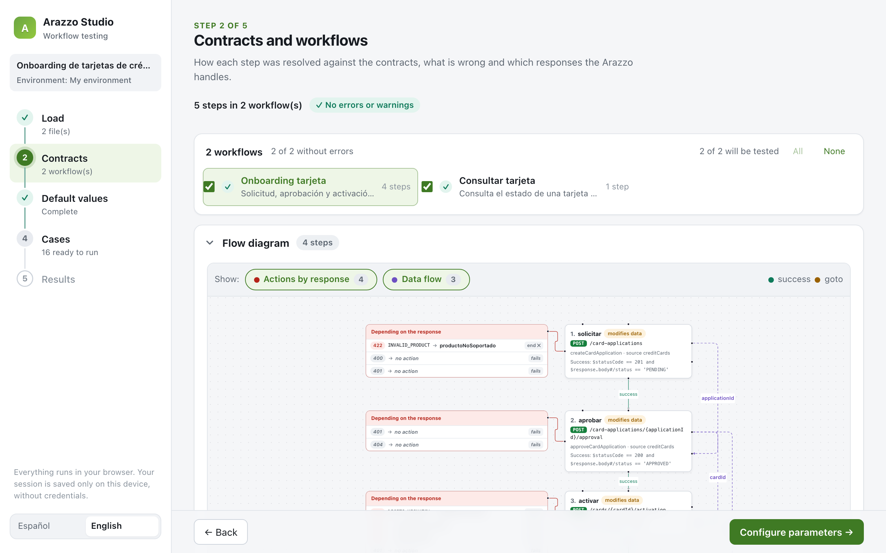
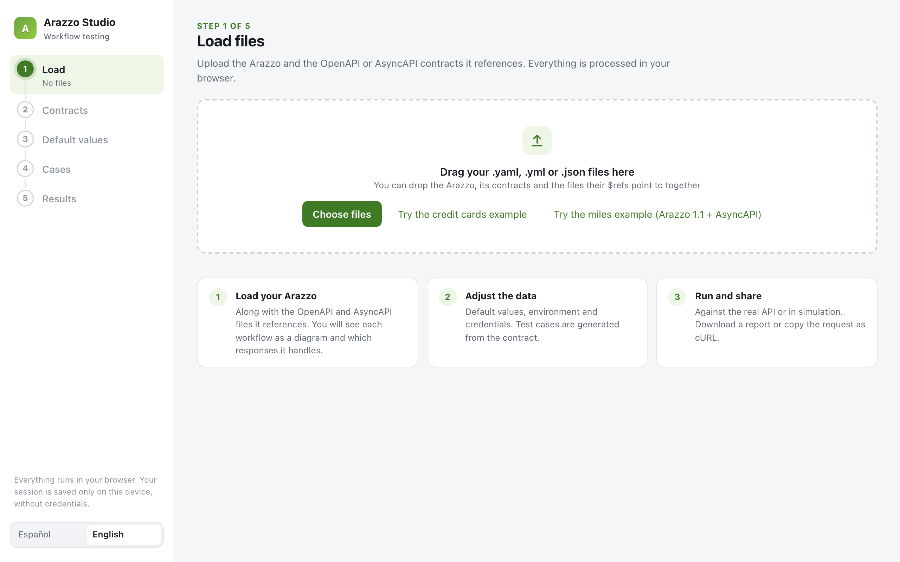
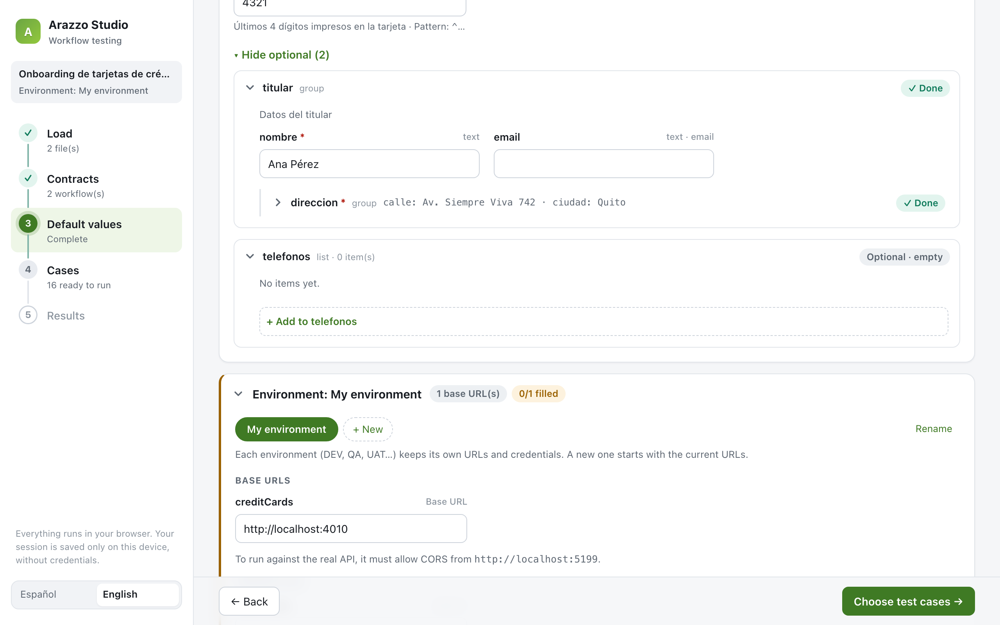
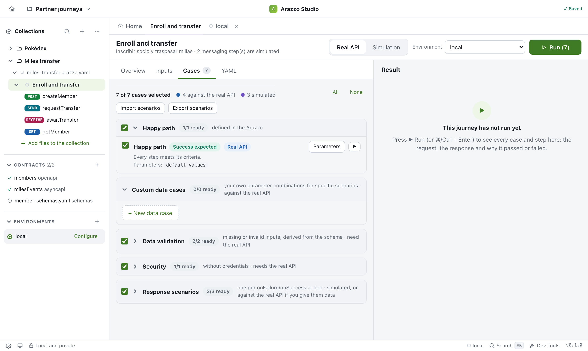
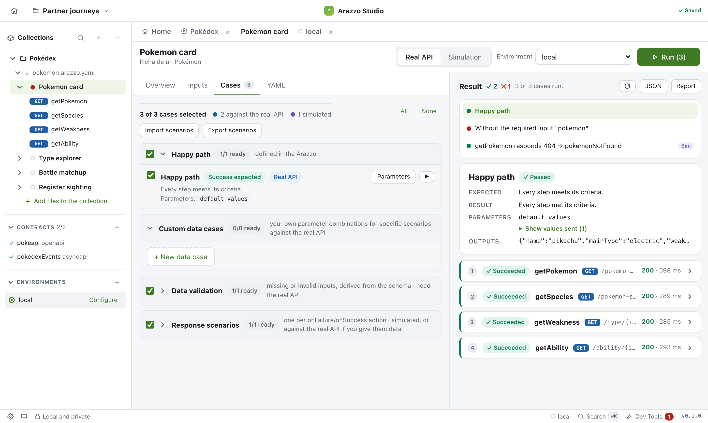
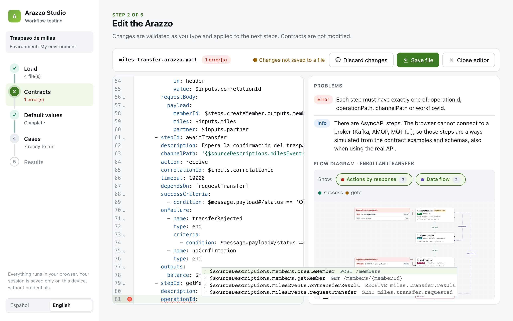
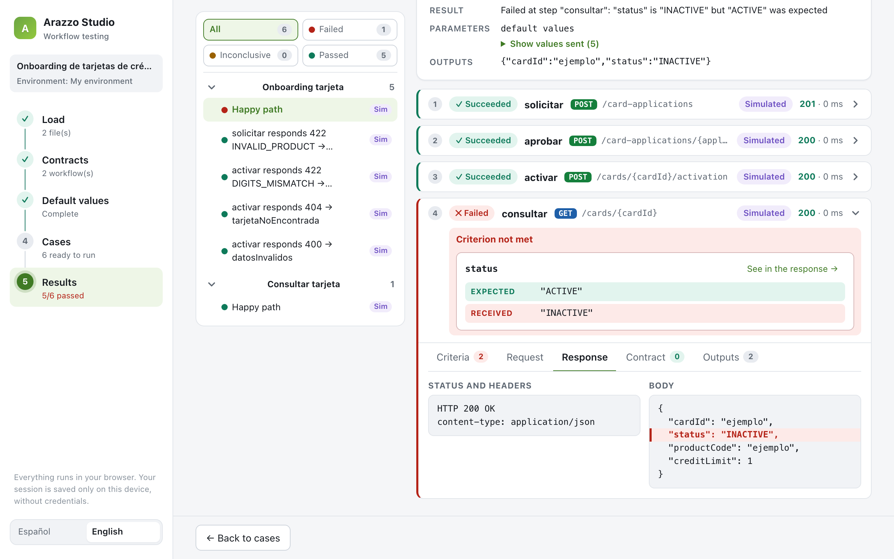
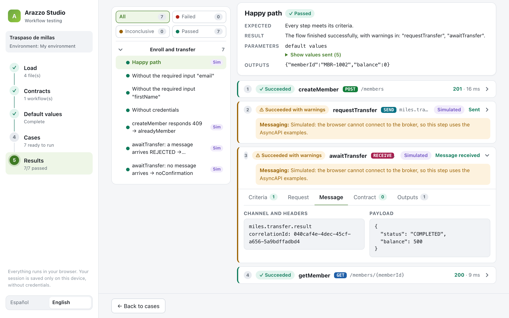
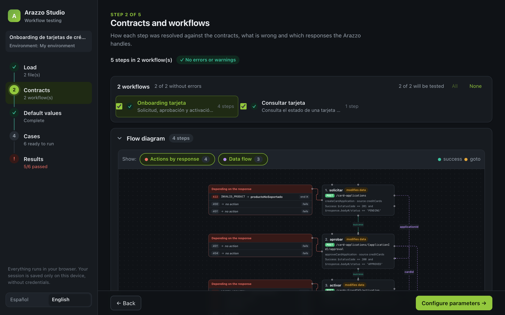
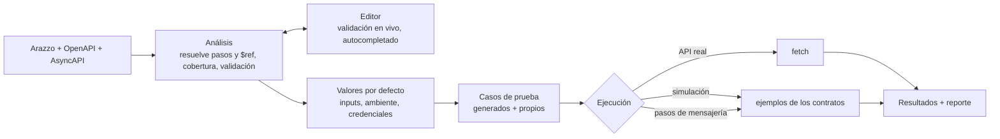

<div align="center">


# Arazzo Studio

**Prueba tus journeys de APIs sin escribir tests.**

Carga un workflow [Arazzo](https://spec.openapis.org/arazzo/latest.html) y los contratos OpenAPI y AsyncAPI que lo respaldan. Arazzo Studio dibuja el journey, genera los casos de prueba, los ejecuta contra tu API o en simulación y explica cada resultado en lenguaje claro. Úsalo en el navegador o como app de escritorio, sin cuenta y sin que nada salga de tu equipo.

[](https://spec.openapis.org/arazzo/latest.html)
[](https://spec.openapis.org/oas/latest.html)
[](https://www.asyncapi.com/docs/reference/specification/latest)
[](#idiomas)
[](LICENSE)
<br>
[](https://react.dev)
[](https://www.typescriptlang.org)
[](https://vite.dev)
[](https://reactflow.dev)
[](https://codemirror.net)
[](https://vitest.dev)
[](https://www.electronjs.org)

[English](README.md) · **Español**

<br>



</div>

<br>

## Contenido

- [Por qué Arazzo Studio](#por-qué-arazzo-studio)
- [Para quién es](#para-quién-es)
- [Funciones](#funciones)
- [Primeros pasos](#primeros-pasos)
- [Cómo funciona](#cómo-funciona)
- [Privacidad y seguridad](#privacidad-y-seguridad)
- [Soporte de las especificaciones](#soporte-de-las-especificaciones)
- [Limitaciones conocidas](#limitaciones-conocidas)
- [Hoja de ruta](#hoja-de-ruta)
- [Idiomas](#idiomas)
- [Para quien contribuye](#para-quien-contribuye)
- [Licencia](#licencia)

## Por qué Arazzo Studio

La mayoría de las integraciones no son una sola llamada, sino un **journey**: inscribir un socio, agregar beneficios de tarjeta, traspasar millas. Cada API suele documentarse y probarse por separado, así que nadie puede comprobar fácilmente que el journey completo funciona, y solo los perfiles técnicos pueden probarlo.

[Arazzo](https://spec.openapis.org/arazzo/latest.html), la especificación de workflows del OpenAPI Initiative, describe esos journeys sobre tus contratos actuales. Arazzo Studio convierte esa descripción en algo que cualquiera del equipo puede ejecutar:

- 🧭 **Ve el journey.** Cada workflow se convierte en un diagrama con sus pasos, las acciones que activa cada respuesta y los datos que pasan entre pasos.
- 🧪 **Casos de prueba sin escribirlos.** Camino feliz, inputs faltantes o inválidos, llamadas sin credenciales y un escenario por cada acción `onSuccess` / `onFailure`, derivados de los contratos.
- 🎛️ **Prueba con tus propios datos.** Agrega casos con otros parámetros, reutilízalos en YAML y repítelos con generadores como `{{email}}` o `{{uuid}}`.
- 🔍 **Entiende los fallos de un vistazo.** En lugar de un JSON crudo, lees *"`status` vale `INACTIVE` pero se esperaba `ACTIVE`"*, con el campo resaltado en la respuesta.
- ✍️ **Corrige el workflow donde lo pruebas.** Un editor integrado valida el Arazzo mientras escribes y sugiere operaciones, pasos y outputs a partir de los contratos.
- 🔒 **Todo local.** Sin backend ni cuenta. Los contratos, las credenciales y las respuestas no salen de tu equipo.
- 🖥️ **Navegador o escritorio.** La app de escritorio trabaja con carpetas como un cliente de APIs tipo Bruno: abre la carpeta del proyecto, guarda el Arazzo sobre su archivo y envía las peticiones sin las restricciones de CORS.

## Para quién es

- **Equipos de producto de APIs y de partners** que venden o documentan journeys formados por varias APIs y necesitan mostrar que funcionan de punta a punta.
- **Product managers y roles de negocio** que necesitan probar un journey con sus propios datos, sin CLI, sin herramientas de pago y sin código de pruebas.
- **QA e ingeniería de integración**, que quieren casos negativos generados, veredictos claros y un reporte para compartir.
- **Quienes diseñan APIs** y escriben archivos Arazzo, con validación en vivo contra los contratos reales.

Arazzo Studio está pensado para **explorar, depurar y mostrar** journeys a mano. No es un runner de CI: para pipelines encaja mejor un runner de línea de comandos como [Redocly Respect](https://redocly.com/docs/respect), y ambos pueden usar los mismos archivos Arazzo.

## Funciones

<table>
  <tr>
    <td width="50%" valign="top">
      
      <h3>1 · Cargar</h3>
      Suelta uno o varios archivos Arazzo (una colección: cada workflow es un journey), los contratos OpenAPI y AsyncAPI que referencian y los archivos a los que apuntan con <code>$ref</code>. La app indica qué contratos o archivos faltan; los contratos se pueden adjuntar a mano o descargar desde su URL.
    </td>
    <td width="50%" valign="top">
      
      <h3>2 · Completar los datos</h3>
      Un formulario generado desde el schema de <code>inputs</code>, con objetos anidados y listas que se llenan campo por campo. Los valores se validan contra el contrato mientras escribes (patrón, longitud, rango, formato).
    </td>
  </tr>
  <tr>
    <td width="50%" valign="top">
      
      <h3>3 · Elegir los casos</h3>
      Casos generados agrupados por tipo, cada uno con sus parámetros. Ejecútalos contra la API real o en simulación, agrega casos con datos propios e importa o exporta escenarios en YAML.
    </td>
    <td width="50%" valign="top">
      
      <h3>4 · Revisar los resultados</h3>
      Progreso en vivo mientras corre y, después, la petición, la respuesta, los criterios, la validación de contrato y los outputs de cada paso. Descarga un reporte HTML autocontenido o una exportación en JSON.
    </td>
  </tr>
</table>

### Editar el Arazzo con validación en vivo

Abre **Editar Arazzo** desde la pantalla de contratos para cambiar el workflow junto a su diagrama. Cada problema queda subrayado en el valor exacto al que se refiere, el diagrama se actualiza mientras escribes y el autocompletado ofrece lo que cuesta recordar: los `operationId` de los contratos cargados (HTTP y AsyncAPI), los canales, `$steps.<paso>.outputs.<nombre>`, `$inputs` y los destinos de `dependsOn` y `goto`. Guarda el archivo en tu equipo o descárgalo; los contratos nunca se modifican.



### Esperado contra recibido, lado a lado

Cuando un criterio falla, Arazzo Studio muestra exactamente qué campo está mal y lo resalta en el body de la respuesta. También funciona con criterios regex sobre un body JSON.



### Pasos de eventos (AsyncAPI)

Los journeys suelen mezclar llamadas REST con eventos. Los pasos que envían (`send`) o reciben (`receive`) un mensaje AsyncAPI aparecen en el diagrama y en los resultados como cualquier otro paso: el mensaje enviado, el mensaje recibido (filtrado por `correlationId`), su validación de contrato y los outputs que salen de `$message`. Los escenarios generados cubren el mensaje que activa cada acción y el caso en que no llega ningún mensaje antes del `timeout`.



> [!NOTE]
> Arazzo Studio todavía no se conecta a brokers como Kafka, AMQP o MQTT, así que los pasos de mensajería **siempre se simulan** con los ejemplos y schemas del AsyncAPI. La app lo avisa antes de ejecutar y marca esos pasos como simulados, también cuando el resto del journey corre contra la API real.

### Además

| Función | Qué hace |
|---|---|
| 🌍 **Ambientes** | DEV, QA, UAT…, cada uno con sus URLs base y credenciales. Al cambiar de ambiente se vuelve a pedir confirmación antes de ejecutar pasos que modifican datos. |
| 🗺️ **Diagrama interactivo** | Arrastra los pasos: sus acciones se mueven con ellos, la disposición se mantiene mientras editas y **Reordenar** vuelve a la automática. |
| 📋 **Copiar como cURL** | Reproduce cualquier petición desde tu terminal. Los secretos quedan como `<secret>` salvo que elijas copiarlos. |
| 🛟 **Ayuda de conexión** | Si la API no responde, un panel guía qué revisar (URL, https/http, CORS) con los headers CORS exactos que hacen falta. |
| ✅ **Elegir workflows** | Selecciona qué workflows probar. Los pasos siguientes solo muestran los elegidos. |
| 💾 **Sesión guardada** | Tu trabajo, incluidos los cambios al Arazzo, se guarda en este equipo y se ofrece al volver. Las credenciales nunca se guardan. |
| 🎲 **Generadores** | Variables dinámicas al estilo de Postman generadas con [Faker](https://fakerjs.dev) (`{{$randomFirstName}}`, `{{$randomEmail}}`, `{{$randomUserAgent}}`, `{{$guid}}`… 47 en total) más `{{cpf}}`, `{{rut}}` y `{{numero:8}}`, para repetir casos sin choques de datos. Escribe `{{` en cualquier campo para verlas. |
| 🌙 **Modo oscuro** | Sigue el tema del sistema. |

<details>
<summary><strong>Vista en modo oscuro</strong></summary>
<br>

</details>

## Primeros pasos

Requiere **Node.js 20.19+ o 22.12+** (lo pide Vite 8).

```bash
npm install
npm run dev          # http://localhost:5173
```

El build es un sitio estático (`npm run build` → `dist/`), así que se puede publicar en cualquier hosting estático o servidor interno. Quien lo usa solo necesita un navegador.

### App de escritorio

La misma app, empaquetada con Electron. Agrega **Abrir carpeta** (todos los YAML y JSON de una carpeta y sus subcarpetas), guarda el Arazzo editado **sobre su archivo** y envía las peticiones desde la propia app, así que **CORS no aplica**.

```bash
npm run desktop:dev      # la app de escritorio contra el servidor de desarrollo
npm run desktop:build    # genera el instalador para tu sistema en release/
```

> [!NOTE]
> Los instaladores todavía **no están firmados**. En macOS, abre la app la primera vez con clic derecho → **Abrir**; en Windows, elige **Más información → Ejecutar de todas formas**.

### Probar los ejemplos incluidos

Los dos ejemplos están a un clic en la pantalla de carga. Para ejecutarlos contra una API real en vez de en simulación, levanta el mock incluido:

```bash
npm run mock         # APIs de ejemplo en http://localhost:4010
npm run mock:bug     # las mismas APIs, con errores de contrato a propósito
```

| Ejemplo | Qué muestra | Cómo ejecutarlo |
|---|---|---|
| **Colección** | Los dos ejemplos de abajo en una colección: dos archivos Arazzo, tres journeys y ambientes compartidos. | Como cada ejemplo. |
| **Tarjetas de crédito** | Un onboarding de cuatro pasos sobre un contrato OpenAPI: casos generados, escenarios por respuesta y errores de contrato. | Cualquier token como credencial y `4321` como `last4Digits`. |
| **Traspaso de millas** | Un journey Arazzo 1.1: un OpenAPI repartido en archivos con `$ref` externos, pasos AsyncAPI `send` / `receive`, `correlationId`, `timeout` y `dependsOn`. | Cualquier token como credencial. Los pasos de mensajería se simulan. |

Los archivos de los ejemplos están en [examples/](examples/).

## Cómo funciona



1. **Contratos.** Cada paso se resuelve a su operación OpenAPI o a su canal AsyncAPI. Una tabla de cobertura muestra qué respuestas documentadas maneja el Arazzo, y la validación señala operaciones inexistentes, parámetros obligatorios que nunca se envían, referencias rotas y pasos que dependen de otros que corren después.
2. **Valores por defecto.** Los valores con que parte cada caso, más el ambiente (URLs base y credenciales tomadas de los `securitySchemes`).
3. **Casos de prueba.** Los casos generales corren contra la API real o en simulación. Los escenarios por respuesta y por mensaje se simulan con los ejemplos del contrato (o su schema si no hay ejemplos) y verifican que se active la acción correcta. Los escenarios HTTP se pueden pasar a la API real dándoles los datos que provocan esa respuesta.
4. **Resultados.** Cada caso termina con un veredicto (pasó, no pasó o no concluyente) y una razón en lenguaje claro.

> [!IMPORTANT]
> En la **versión web**, las peticiones salen del navegador, así que la API probada debe permitir **CORS** desde el origen de la app (por ejemplo `http://localhost:5173`) e incluir en `Access-Control-Allow-Headers` los headers que envían los workflows. Cuando una petición se bloquea, la app muestra un panel con los headers exactos que hay que agregar. La **app de escritorio** envía las peticiones desde la propia app, así que CORS no aplica.

## Privacidad y seguridad

- Todo corre **en tu equipo**, en el navegador o en la app de escritorio. No hay backend ni cuenta.
- La app de escritorio solo escribe en archivos que abriste o elegiste en un diálogo, y su interfaz no tiene acceso directo a Node ni al sistema de archivos.
- Las credenciales viven **solo en la pestaña abierta**: nunca se guardan, se exportan ni van en los reportes.
- Tokens, contraseñas y API keys se **enmascaran** en resultados, reportes, exportaciones y comandos cURL (salvo que elijas copiarlos).
- La sesión guardada (IndexedDB) omite las credenciales y cualquier input con nombre sensible (`token`, `password`, `secret`…).

## Soporte de las especificaciones

Se soportan documentos Arazzo **1.0.x** y **1.1.x**, con contratos OpenAPI **3.x** y AsyncAPI **2.x** y **3.x**.

| Elemento | Estado |
|---|---|
| `operationId` (simple y `$sourceDescriptions.x.opId`) | ✅ Soportado |
| `operationPath` | ✅ Soportado |
| Pasos con `workflowId` (sub-workflows) | ✅ Soportado |
| Parámetros path, query y header | ✅ Soportado |
| Parámetros `in: querystring` (1.1) | ✅ Soportado |
| Parámetros cookie | ❌ No soportado (restricción del navegador) |
| `requestBody` con `payload` y `replacements` | ✅ Soportado (`targetSelectorType` JSON Pointer y JSONPath) |
| `successCriteria` simple, regex y JSONPath | ✅ Soportado (JSONPath con sintaxis de jsonpath-plus) |
| `successCriteria` y selectores XPath | ❌ No soportado |
| `onSuccess` / `onFailure`: `end`, `goto`, `retry` | ✅ Soportado |
| `parameters` en las acciones (1.1) | ✅ Soportado en `goto` y `retry` con `workflowId` |
| Selector Object en outputs, parámetros y payloads (1.1) | ✅ Soportado (JSONPath y JSON Pointer) |
| `components` (parameters, successActions, failureActions, inputs) | ✅ Soportado |
| Fuentes AsyncAPI (1.1): `channelPath`, `action`, `correlationId`, `$message` | ✅ Soportado, siempre simulado |
| `timeout` de un paso (1.1) | ✅ Soportado |
| `dependsOn` de un paso (1.1) | ✅ Se valida en el análisis y antes de cada paso; los pasos corren en el orden del documento |
| `dependsOn` de un workflow | ⚠️ No se ejecuta automáticamente |
| `$ref` externos en OpenAPI, AsyncAPI y Arazzo | ✅ Soportado entre los archivos cargados (y descargados junto a un contrato que se baja de su URL) |

## Limitaciones conocidas

- **Los pasos de mensajería se simulan.** Arazzo Studio todavía no se conecta a brokers.
- **CORS (solo en la versión web).** La API probada tiene que permitir el origen de la app. Los navegadores no pueden enviar cookies ni el header `Host`, y solo leen los headers de respuesta que la API exponga. La app de escritorio no tiene estas restricciones.
- **Instaladores sin firmar.** macOS y Windows muestran una advertencia la primera vez que se abre la app.
- **XPath** en criterios y selectores no está soportado.
- **`retry` con `stepId`** y el **`dependsOn` de un workflow** no se ejecutan automáticamente.
- **No es un runner de CI.** Las ejecuciones las inicia una persona desde el navegador.
- **Todavía no hay versión publicada en línea.** Se ejecuta localmente, como app de escritorio o publicando el build estático.

## Hoja de ruta

Próximos pasos previstos, sin un orden fijo:

- **Demo en línea** con los ejemplos incluidos, para probar la app sin instalar nada.
- **Mensajería real en la app de escritorio:** conectar los pasos `send` / `receive` a Kafka, AMQP o MQTT en lugar de simularlos.
- **Instaladores de escritorio firmados** y con actualizaciones automáticas.
- **Edición asistida por IA** (opcional, con tu propia API key): describe un cambio en lenguaje natural y revísalo como diff antes de aplicarlo.
- **Diagrama más completo:** flechas de `dependsOn` y `timeout` en los pasos.
- **Simulaciones editables:** ajustar la respuesta o el mensaje simulado de un escenario para probar casos de negocio sin tocar YAML.
- **Cargar una carpeta completa,** para que los contratos de varios archivos entren de una vez.

Las ideas y comentarios son bienvenidos en los [issues](https://github.com/bvegaM/arazzo-studio/issues).

## Idiomas

La interfaz está en **inglés** y **español**. El idioma inicial se toma del navegador y se puede cambiar en la barra lateral. También se traducen los mensajes del motor y el reporte HTML. Los archivos de escenarios mantienen las mismas claves en ambos idiomas, para que sigan siendo compatibles.

## Para quien contribuye

### Estructura del proyecto

```
src/
  app/          composición de la app: navegación entre pantallas, estado (useStudio) y barra lateral
  core/         motor independiente de la UI (sin React ni DOM): carga y resolución de $ref,
                resolución de OpenAPI y AsyncAPI, análisis, runner, criterios,
                simulador, casos de prueba, ayudas del editor, reporte, ambientes, sesión…
  i18n/         traducciones (en, es), t() y el hook useLocale
  lib/          utilidades del navegador y del escritorio (descargas, portapapeles, IndexedDB, puente de escritorio)
  ui/
    components/ piezas reutilizables (diagrama, editor del Arazzo, formulario de schema, selector de workflows…)
    screens/    una pantalla por paso
electron/       app de escritorio: proceso principal (HTTP sin CORS, archivos), puente de preload y lanzador de desarrollo
examples/       ejemplos de tarjetas de crédito y traspaso de millas, y la API mock
docs/           capturas de pantalla
```

`core` nunca importa de `ui`, `app` ni `lib`, así que el motor se puede reutilizar fuera del navegador. Las llamadas HTTP pasan por un `HttpExecutor` (`fetch` en el navegador, el proceso principal de Electron en escritorio, o el simulador basado en el contrato) y los pasos de mensajería por un `MessageExecutor` (hoy, el simulador). El diagrama (React Flow) y el editor (CodeMirror) se cargan solo cuando se usan, para que la carga inicial sea liviana.

### Scripts

| Comando | Qué hace |
|---|---|
| `npm run dev` | Levanta el servidor de desarrollo |
| `npm run build` | Revisa tipos y genera el build de producción |
| `npm run preview` | Sirve el build de producción |
| `npm test` | Corre las pruebas (motor, criterios, análisis, ayudas del editor, ejecución contra el mock) |
| `npm run typecheck` | Revisa tipos de la app, la configuración y las pruebas |
| `npm run lint` | Lint con oxlint |
| `npm run mock` / `npm run mock:bug` | Levanta las APIs de ejemplo (correctas / con errores de contrato) |
| `npm run desktop:dev` | Abre la app de escritorio contra el servidor de desarrollo |
| `npm run desktop:build` | Genera el instalador de escritorio del sistema actual en `release/` |

### Agregar un texto

Añade la clave en `src/i18n/locales/es/` y su traducción en `src/i18n/locales/en/`. TypeScript avisa si falta alguna.

## Licencia

[MIT](LICENSE) © bvegam

<sub>Arazzo y OpenAPI son especificaciones del <a href="https://www.openapis.org">OpenAPI Initiative</a>, y AsyncAPI de la <a href="https://www.asyncapi.com">AsyncAPI Initiative</a>. Este proyecto no está afiliado ni respaldado por ninguna de ellas.</sub>
