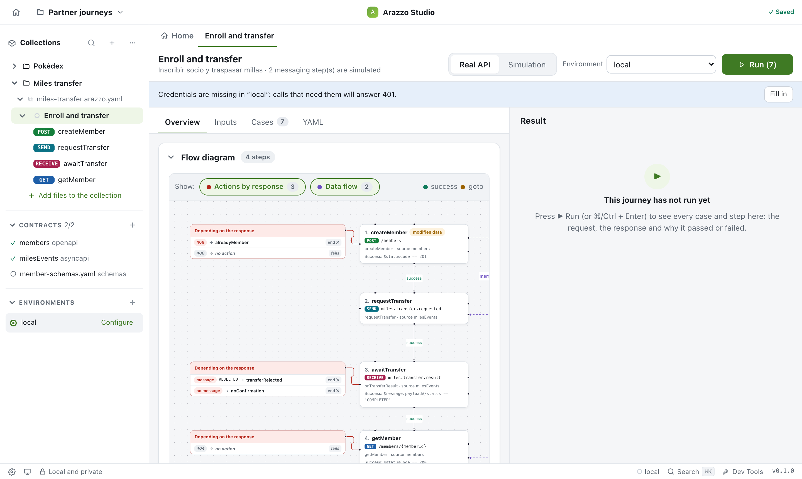
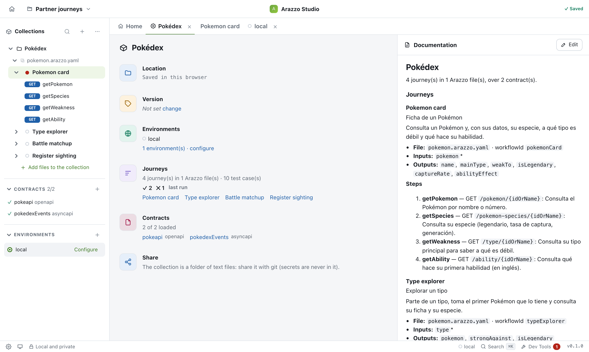
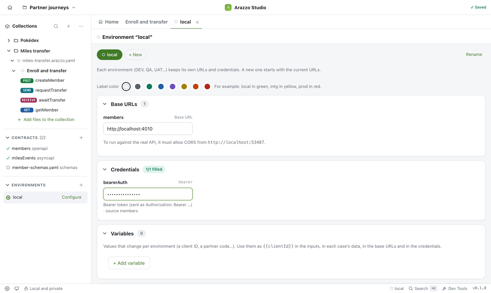
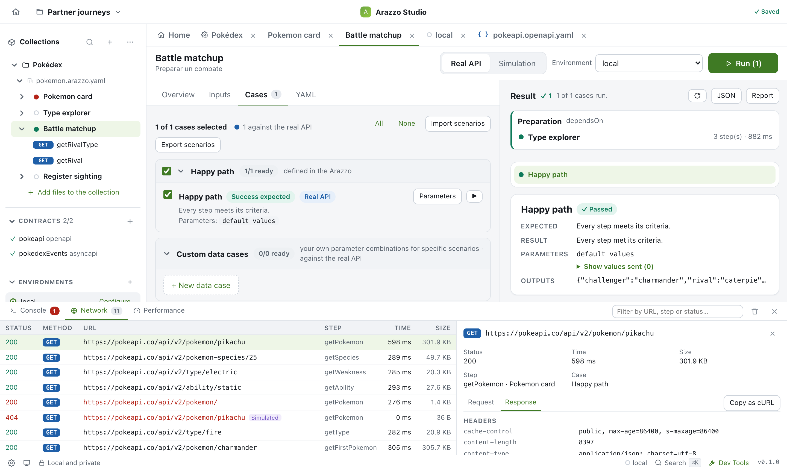
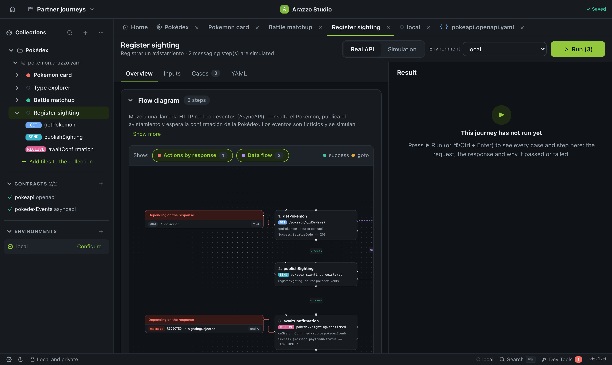
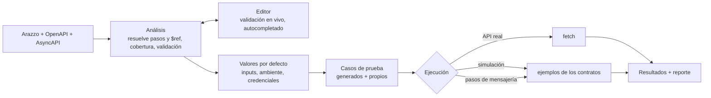

<div align="center">


# Arazzo Studio

**Prueba tus journeys de APIs sin escribir tests.**

Carga un workflow [Arazzo](https://spec.openapis.org/arazzo/latest.html) y los contratos OpenAPI y AsyncAPI que lo respaldan. Arazzo Studio dibuja el journey, genera los casos de prueba, los ejecuta contra tu API o en simulación y explica cada resultado en lenguaje claro. Organiza todo en un workspace de carpetas como Bruno, edita los contratos como en Swagger Editor y úsalo en el navegador o como app de escritorio, sin cuenta y sin que nada salga de tu equipo.

[](https://spec.openapis.org/arazzo/latest.html)
[](https://spec.openapis.org/oas/latest.html)
[](https://www.asyncapi.com/docs/reference/specification/latest)
[](#idiomas)
[](LICENSE)
<br>
[](https://react.dev)
[](https://www.typescriptlang.org)
[](https://vite.dev)
[](https://reactflow.dev)
[](https://codemirror.net)
[](https://vitest.dev)
[](https://www.electronjs.org)

[English](README.md) · **Español**

<br>



</div>

<br>

## Contenido

- [Por qué Arazzo Studio](#por-qué-arazzo-studio)
- [Para quién es](#para-quién-es)
- [Funciones](#funciones)
- [Primeros pasos](#primeros-pasos) · [Tour guiado](#tour-guiado-y-ejemplo)
- [Cómo funciona](#cómo-funciona)
- [Privacidad y seguridad](#privacidad-y-seguridad)
- [Soporte de las especificaciones](#soporte-de-las-especificaciones)
- [Limitaciones conocidas](#limitaciones-conocidas)
- [Hoja de ruta](#hoja-de-ruta)
- [Idiomas](#idiomas)
- [Para quien contribuye](#para-quien-contribuye)
- [Licencia](#licencia)

## Por qué Arazzo Studio

La mayoría de las integraciones no son una sola llamada, sino un **journey**: inscribir un socio, agregar beneficios de tarjeta, traspasar millas. Cada API suele documentarse y probarse por separado, así que nadie puede comprobar fácilmente que el journey completo funciona, y solo los perfiles técnicos pueden probarlo.

[Arazzo](https://spec.openapis.org/arazzo/latest.html), la especificación de workflows del OpenAPI Initiative, describe esos journeys sobre tus contratos actuales. Arazzo Studio convierte esa descripción en algo que cualquiera del equipo puede ejecutar:

- 🧭 **Ve el journey.** Cada workflow se convierte en un diagrama con sus pasos, las acciones que activa cada respuesta y los datos que pasan entre pasos.
- 🧪 **Casos de prueba sin escribirlos.** Camino feliz, inputs faltantes o inválidos, llamadas sin credenciales y un escenario por cada acción `onSuccess` / `onFailure`, derivados de los contratos.
- 🎛️ **Prueba con tus propios datos.** Agrega casos con otros parámetros, reutilízalos en YAML y repítelos con generadores como `{{email}}` o `{{uuid}}`.
- 🔍 **Entiende los fallos de un vistazo.** En lugar de un JSON crudo, lees *"`status` vale `INACTIVE` pero se esperaba `ACTIVE`"*, con el campo resaltado en la respuesta.
- ✍️ **Corrige el workflow donde lo pruebas.** Un editor integrado valida el Arazzo mientras escribes y sugiere operaciones, pasos y outputs a partir de los contratos.
- 📁 **Trabaja como en Bruno.** Un workspace es una carpeta: cada colección es una subcarpeta con sus Arazzo, contratos, ambientes y casos como archivos de texto que puedes versionar en git. Cada cambio se guarda solo.
- 📜 **Edita los contratos como en Swagger Editor.** El YAML junto a la Swagger UI oficial, con errores en vivo y un aviso cuando un cambio rompe un journey. Prueba cualquier operación por sí sola con tu ambiente.
- 🔒 **Todo local.** Sin backend ni cuenta. Los secretos y las credenciales se guardan cifrados en tu equipo y nunca en los archivos del workspace.
- 🖥️ **Navegador o escritorio.** La app de escritorio envía las peticiones sin las restricciones de CORS y suma una terminal integrada.

## Para quién es

- **Equipos de producto de APIs y de partners** que venden o documentan journeys formados por varias APIs y necesitan mostrar que funcionan de punta a punta.
- **Product managers y roles de negocio** que necesitan probar un journey con sus propios datos, sin CLI, sin herramientas de pago y sin código de pruebas.
- **QA e ingeniería de integración**, que quieren casos negativos generados, veredictos claros, un reporte para compartir y Dev Tools con cada petición.
- **Quienes diseñan APIs** y escriben archivos Arazzo, con validación en vivo contra los contratos reales.

Arazzo Studio está pensado para **explorar, depurar y mostrar** journeys a mano. No es un runner de CI: para pipelines encaja mejor un runner de línea de comandos como [Redocly Respect](https://redocly.com/docs/respect), y ambos pueden usar los mismos archivos Arazzo.

## Funciones

### Un workspace de carpetas, como Bruno

Crea un workspace donde elijas (la app de escritorio propone `Documentos/Arazzo Studio`) y agrega colecciones: una por partner o por tema. Cada colección guarda sus Arazzo, contratos, ambientes y casos de prueba como archivos de texto, así que el workspace completo puede vivir en git y compartirse con el equipo. Cada cambio se guarda solo.

La pestaña **Inicio** muestra las colecciones con sus carpetas, acciones rápidas y la documentación del workspace, un `README.md` que escribes y ves ahí mismo. Cada colección tiene también su **resumen**: ubicación, versión, ambientes, journeys con la última ejecución, contratos, cómo compartirla y su documentación, que **Generar documentación** arma a partir de los Arazzo (journeys, inputs, pasos, contratos y ambientes).




```
partner-journeys/
  studio.yaml              nombre y colecciones del workspace
  README.md                documentación del workspace
  pokedex/                 una colección
    collection.yaml
    pokemon.arazzo.yaml, pokeapi.openapi.yaml, …
    environments/*.yaml    URLs base, variables y color (de los secretos, solo el nombre)
    scenarios/<arazzo>     inputs base y casos propios de cada Arazzo
```

### Journeys, casos y resultados lado a lado

Elige un journey a la izquierda: su diagrama, sus inputs y sus casos generados quedan al centro y los resultados a la derecha. Los casos cubren el camino feliz, inputs faltantes o inválidos, llamadas sin credenciales y un escenario por cada acción `onSuccess` / `onFailure`. Ejecútalos contra la API real o en simulación, agrega tus propios casos con datos y lee cada veredicto en lenguaje claro.


### Ambientes con variables y secretos

Local, integración, producción… cada ambiente tiene sus URLs base, credenciales, variables y secretos, y una etiqueta de color. Escribe `{{` en cualquier campo para elegir una variable o un generador. Los secretos se tapan en todas partes y se guardan cifrados en este equipo, nunca en los archivos del workspace.



### Contratos como en Swagger Editor

Abre cualquier contrato OpenAPI para editar su YAML junto a la **Swagger UI** oficial, que se actualiza mientras escribes. Los errores aparecen arriba con su línea, y un aviso indica cuando un cambio rompe un journey que usa el contrato. **Try it out** pasa por Arazzo Studio: el servidor del ambiente aparece primero, las credenciales ya están autorizadas, los secretos se tapan en el cURL y cada llamada queda en Dev Tools. Cualquier operación también se puede probar sola desde un paso del journey. Crea contratos OpenAPI o AsyncAPI nuevos desde la barra lateral.


### Autorización de los journeys, por API y por journey

Arazzo no define cómo autenticarse, y modelar un flujo OAuth 2.0 como pasos del Arazzo es engorroso (y con *authorization code*, imposible). En la pestaña **Autorización** de un journey eliges la de cada API que llama: para **todos los journeys** que usan esa API o **solo para ese journey**. Gana la más específica, y por defecto se usan las credenciales del contrato, como siempre. Están los mismos tipos que en los requests, incluido heredar la de la colección. Se aplica en cada paso de cada ejecución contra la API real: el token de OAuth 2.0 se pide una vez y se reutiliza entre pasos y casos, y si hace falta iniciar sesión, un botón lo pide antes de ejecutar. El caso "sin credenciales" la quita, y en simulación no se usa. El Arazzo no se modifica: la configuración vive en `flow-auth.yaml` de la colección, sin secretos escritos tal cual.

### Requests sueltos: HTTP, GraphQL, gRPC y WebSocket

Como en Postman, cada colección puede tener sus propios requests, además de los journeys. Crea uno desde **Nuevo request** en la barra lateral o en el menú `⋯` de la colección:

- **HTTP (REST):** método, URL, params, headers, autorización (Bearer, Basic o API key) y body (JSON, texto, XML, `x-www-form-urlencoded` o `form-data`). La respuesta muestra el estado, el tiempo, el tamaño, el body formateado y los headers.
- **GraphQL:** query y variables, enviadas como JSON.
- **gRPC (app de escritorio):** importa el `.proto`, elige el método y escribe el mensaje a partir de un ejemplo generado. Funciona con llamadas unarias y con streaming, y muestra el código de estado, la metadata y los trailers.
- **WebSocket:** conecta, guarda varios mensajes para reenviarlos y revisa el historial de lo enviado (↑) y lo recibido (↓). La conexión sigue abierta aunque cambies de pestaña.
- **Desde cURL:** pega un comando copiado de Chrome, de Postman o de la documentación de una API, en el diálogo o directamente en la URL.

**Autorización**, con los mismos tipos que Bruno: AWS Sig v4, Basic, Bearer, Digest, NTLM, OAuth 1.0, OAuth 2.0 (authorization code con PKCE, client credentials y password; el token se pide y se refresca solo), WSSE, API Key y Akamai EdgeGrid. Cada request puede **heredar** la autorización de la colección, que se configura en su resumen. Lo que se escribe tal cual en un campo secreto se guarda cifrado en el equipo, no en el archivo. Para compartir la configuración con el equipo, se usan `{{variables}}` del ambiente.

Todos usan las `{{variables}}` del ambiente activo, y sus llamadas aparecen en Dev Tools con los secretos tapados. Cada request se guarda como un YAML legible en `requests/<nombre>.request.yaml` dentro de la colección, y los `.proto` en `protos/`. Así se versionan junto con todo lo demás.


### Editar el Arazzo con validación en vivo

La pestaña **YAML** de un journey valida el Arazzo mientras escribes. Cada problema se subraya en el valor exacto al que se refiere, y el autocompletado ofrece los operationId de los contratos cargados (HTTP y AsyncAPI), canales, `$steps.<paso>.outputs.<nombre>`, `$inputs` y destinos de `dependsOn` y `goto`.


### Dev Tools: Console, Network, Performance y Terminal

Como en Bruno, la barra inferior abre un panel con la **Console** (cada ejecución, caso y paso, y los eventos de la app), **Network** (cada petición y mensaje con headers, body y *Copiar como cURL*, con los secretos tapados), **Performance** (CPU, memoria y tiempo por paso) y, en la app de escritorio, una **Terminal** con varias sesiones que se abre en la carpeta del workspace o de una colección. La interfaz **Simple** (Preferencias) lo oculta todo para quien solo prueba journeys.



### Pasos de eventos (AsyncAPI)

Los journeys suelen mezclar llamadas REST con eventos. Los pasos que hacen `send` o `receive` de un mensaje AsyncAPI aparecen en el diagrama y en los resultados como cualquier otro paso: el mensaje enviado, el mensaje recibido (asociado por `correlationId`), su revisión contra el contrato y los outputs tomados de `$message`. Los escenarios generados cubren el mensaje que activa cada acción y el caso en que no llega ningún mensaje antes del `timeout`.

> [!NOTE]
> Arazzo Studio todavía no se conecta a brokers como Kafka, AMQP o MQTT, así que los pasos de mensajería **siempre se simulan** a partir de los ejemplos y schemas del AsyncAPI. La app lo avisa antes de ejecutar y marca esos pasos como simulados, también cuando el resto del journey corre contra la API real.

### Además

| Función | Qué hace |
|---|---|
| 🔎 **Buscar en todo** | ⌘K / Ctrl+K salta a cualquier journey, paso, ambiente, contrato o colección. La búsqueda de la barra lateral filtra el árbol mientras escribes. |
| 🗺️ **Diagrama interactivo** | Mueve los pasos; sus acciones los acompañan, y **Restablecer diseño** vuelve al automático. |
| 📋 **Copiar como cURL** | Reproduce cualquier petición desde tu terminal. Los secretos quedan como `<secret>`. |
| 🛟 **Ayuda de conexión** | Si la API no responde, un panel guiado explica qué revisar (URL, https/http, CORS) y te da los headers CORS exactos que hay que agregar. |
| 🎲 **Generadores** | Variables dinámicas al estilo de Postman con [Faker](https://fakerjs.dev) (`{{$randomFirstName}}`, `{{$randomEmail}}`, `{{$guid}}`… 47 en total) y además `{{cpf}}`, `{{rut}}` y `{{number:8}}`. |
| 📄 **Reportes** | Un reporte HTML autocontenido o una exportación JSON de cada ejecución. |
| 🌙 **Temas** | Claro, oscuro o el del sistema, desde la barra inferior o Preferencias. |
| 💾 **Sin workspace** | Abre archivos o una carpeta para una prueba rápida; tu sesión se guarda en este equipo sin credenciales. |

<details>
<summary><strong>Vista en modo oscuro</strong></summary>
<br>

</details>

## Primeros pasos

Requiere **Node.js 20.19+ o 22.12+** (lo pide Vite 8).

```bash
npm install
npm run dev          # http://localhost:5173
```

El build es un sitio estático (`npm run build` → `dist/`), así que se puede publicar en cualquier hosting estático o servidor interno. Quien lo usa solo necesita un navegador.

### App de escritorio

La misma app, empaquetada con Electron. Los workspaces viven en carpetas reales del disco (con **Mostrar en Finder**), los secretos se cifran con el llavero del sistema operativo, las peticiones salen de la propia app, así que **CORS no aplica**, y Dev Tools suma una **Terminal**.

```bash
npm run desktop:dev      # la app de escritorio contra el servidor de desarrollo
npm run desktop:build    # genera el instalador para tu sistema en release/
```

> [!NOTE]
> Los instaladores todavía **no están firmados**. En macOS, abre la app la primera vez con clic derecho → **Abrir**; en Windows, elige **Más información → Ejecutar de todas formas**.

### Tour guiado y ejemplo

La bienvenida ofrece un **tour guiado** (también en Preferencias): en unos cinco minutos recorre todas las funciones sobre una **Pokédex** que llama a la [PokéAPI](https://pokeapi.co) real, una API pública sin credenciales y con CORS permitido. Crea un workspace de prueba, ejecuta los journeys contra la API real y, al final, te deja quedártelo o eliminarlo. **Probar el ejemplo** abre la misma Pokédex sin workspace.


| Journey | Qué muestra |
|---|---|
| **Pokemon card** | Cuatro pasos que se encadenan con sus outputs (un Pokémon, su especie, su debilidad, su habilidad), criterios JSONPath y una acción de fin ante un 404. |
| **Type explorer** | Un tipo, su primer Pokémon y su especie. |
| **Battle matchup** | `dependsOn` de un workflow: corre después de *Type explorer* y usa sus outputs para buscar un rival. |
| **Register sighting** | Una llamada HTTP real y pasos AsyncAPI `send` / `receive` con `correlationId` y `timeout`. Estos eventos son ficticios y siempre se simulan. |

Los archivos del ejemplo están en [examples/pokemon/](examples/pokemon/).

## Cómo funciona



1. **Contratos.** Cada paso se resuelve a su operación OpenAPI o a su canal AsyncAPI. Una tabla de cobertura muestra qué respuestas documentadas maneja el Arazzo, y la validación señala operaciones inexistentes, parámetros obligatorios que nunca se envían, referencias rotas y pasos que dependen de otros que corren después.
2. **Valores por defecto.** Los valores con que parte cada caso, más el ambiente (URLs base y credenciales tomadas de los `securitySchemes`).
3. **Casos de prueba.** Los casos generales corren contra la API real o en simulación. Los escenarios por respuesta y por mensaje se simulan con los ejemplos del contrato (o su schema si no hay ejemplos) y verifican que se active la acción correcta. Los escenarios HTTP se pueden pasar a la API real dándoles los datos que provocan esa respuesta.
4. **Resultados.** Cada caso termina con un veredicto (pasó, no pasó o no concluyente) y una razón en lenguaje claro.

> [!IMPORTANT]
> En la **versión web**, las peticiones salen del navegador, así que la API probada debe permitir **CORS** desde el origen de la app (por ejemplo `http://localhost:5173`) e incluir en `Access-Control-Allow-Headers` los headers que envían los workflows. Cuando una petición se bloquea, la app muestra un panel con los headers exactos que hay que agregar. La **app de escritorio** envía las peticiones desde la propia app, así que CORS no aplica.

## Privacidad y seguridad

- Todo corre **en tu equipo**, en el navegador o en la app de escritorio. No hay backend ni cuenta.
- **Los secretos y las credenciales nunca se escriben en los archivos del workspace**: los archivos de ambientes solo guardan el nombre de los secretos. Sus valores se guardan **cifrados en este equipo**, con el llavero del sistema operativo en la app de escritorio (`safeStorage` de Electron) y con WebCrypto en el navegador.
- Tokens, contraseñas y API keys se **tapan** en los resultados, reportes, exportaciones, Dev Tools, el cURL de Swagger UI y *Copiar como cURL*.
- La app de escritorio solo lee y escribe dentro de las carpetas que elegiste, y su interfaz no tiene acceso directo a Node ni al sistema de archivos. La terminal integrada abre tu propia shell, solo en una carpeta de workspace o en tu carpeta personal.
- Sin workspace, la sesión guardada (IndexedDB) deja fuera las credenciales y cualquier input cuyo nombre parezca sensible (`token`, `password`, `secret`…).

## Soporte de las especificaciones

Se soportan documentos Arazzo **1.0.x** y **1.1.x**, con contratos OpenAPI **3.x** y AsyncAPI **2.x** y **3.x**.

| Elemento | Estado |
|---|---|
| `operationId` (simple y `$sourceDescriptions.x.opId`) | ✅ Soportado |
| `operationPath` | ✅ Soportado |
| Pasos con `workflowId` (sub-workflows) | ✅ Soportado |
| Parámetros path, query y header | ✅ Soportado |
| Parámetros `in: querystring` (1.1) | ✅ Soportado |
| Parámetros cookie y API keys `in: cookie` | ✅ En la app de escritorio · ⚠️ en la web no (el navegador no permite enviar cookies; el resultado lo explica) |
| `requestBody` con `payload` y `replacements` | ✅ Soportado (`targetSelectorType` JSON Pointer, JSONPath y XPath sobre payloads XML) |
| `successCriteria` simple, regex y JSONPath | ✅ Soportado (JSONPath con sintaxis de jsonpath-plus) |
| `successCriteria` y selectores XPath | ✅ XPath 1.0 sobre respuestas XML (también si se declara `xpath-20` o `xpath-30`, con las expresiones compatibles con 1.0) |
| `onSuccess` / `onFailure`: `end`, `goto`, `retry` | ✅ Soportado |
| `parameters` en las acciones (1.1) | ✅ Soportado en `goto` y `retry` con `workflowId` |
| Selector Object en outputs, parámetros y payloads (1.1) | ✅ Soportado (JSONPath, JSON Pointer y XPath) |
| `components` (parameters, successActions, failureActions, inputs) | ✅ Soportado |
| Fuentes AsyncAPI (1.1): `channelPath`, `action`, `correlationId`, `$message` | ✅ Soportado, siempre simulado |
| `timeout` de un paso (1.1) | ✅ Soportado |
| `dependsOn` de un paso (1.1) | ✅ Se valida en el análisis y antes de cada paso; los pasos corren en el orden del documento |
| `dependsOn` de un workflow | ✅ Los workflows de los que depende corren antes (una vez por ejecución) y sus outputs quedan en `$workflows.<id>.outputs`; se detectan ciclos. Solo del mismo documento |
| `$ref` externos en OpenAPI, AsyncAPI y Arazzo | ✅ Soportado entre los archivos cargados (y descargados junto a un contrato que se baja de su URL) |

## Limitaciones conocidas

- **Los pasos de mensajería se simulan.** Arazzo Studio todavía no se conecta a brokers.
- **CORS (solo en la versión web).** La API probada tiene que permitir el origen de la app. Los navegadores no pueden enviar cookies ni el header `Host`, y solo leen los headers de respuesta que la API exponga. La app de escritorio no tiene estas restricciones: ahí las cookies sí se envían.
- **Instaladores sin firmar.** macOS y Windows muestran una advertencia la primera vez que se abre la app.
- **Probada en macOS.** Las versiones para Windows y Linux todavía no se probaron en esos sistemas; en Linux la terminal necesita compilar su módulo nativo al instalar.
- **gRPC solo en la app de escritorio**, porque el navegador no puede abrir conexiones gRPC. Todavía no se usa *server reflection*: hace falta el `.proto`. En los métodos con streaming del cliente se envía un solo mensaje.
- **NTLM solo en la app de escritorio**, porque su intercambio necesita una sola conexión. Los tokens de OAuth 2.0 se guardan solo en memoria mientras la colección está abierta. En la versión web, el *authorization code* vuelve a `<origen>/oauth2/callback`, y esa URL tiene que estar registrada en el proveedor.
- **WebSocket sin headers propios.** Los navegadores no los permiten; se pueden usar params en la URL.
- **`form-data` solo con campos de texto** (todavía no se adjuntan archivos).
- **Swagger UI solo para OpenAPI.** Los contratos AsyncAPI y los archivos de schemas usan la vista propia de Arazzo Studio.
- **XPath 1.0.** Las funciones propias de XPath 2.0 o 3.0 no están disponibles.
- **`retry` con `stepId`** no se ejecuta automáticamente, y el **`dependsOn` hacia otro documento Arazzo** se informa pero no se ejecuta.
- **No es un runner de CI.** Las ejecuciones las inicia una persona desde el navegador.
- **Todavía no hay versión publicada en línea.** Se ejecuta localmente, como app de escritorio o publicando el build estático.

## Hoja de ruta

Próximos pasos previstos, sin un orden fijo:

- **Demo en línea** con los ejemplos incluidos, para probar la app sin instalar nada.
- **Mensajería real en la app de escritorio:** conectar los pasos `send` / `receive` a Kafka, AMQP o MQTT en lugar de simularlos.
- **Instaladores de escritorio firmados** y con actualizaciones automáticas.
- **Edición asistida por IA** (opcional, con tu propia API key): describe un cambio en lenguaje natural y revísalo como diff antes de aplicarlo.
- **Diagrama más completo:** flechas de `dependsOn` y `timeout` en los pasos.
- **Simulaciones editables:** ajustar la respuesta o el mensaje simulado de un escenario para probar casos de negocio sin tocar YAML.
- **Generar un primer Arazzo desde los contratos** (o con IA), para que los equipos sin archivos Arazzo empiecen en minutos.
- **Agregar una operación probada como paso** del Arazzo.

Las ideas y comentarios son bienvenidos en los [issues](https://github.com/bvegaM/arazzo-studio/issues).

## Idiomas

La interfaz está en **inglés** y **español**. El idioma inicial se toma del navegador y se puede cambiar en **Preferencias** (barra inferior). También se traducen los mensajes del motor y el reporte HTML. Los archivos de escenarios mantienen las mismas claves en ambos idiomas, para que sigan siendo compatibles.

## Para quien contribuye

### Estructura del proyecto

```
src/
  app/          composición de la app: layout del workspace, estado (useStudio, useWorkspace),
                barra lateral, barra superior, barra inferior, inicio
  core/         motor independiente de la interfaz (sin React ni DOM): carga y $ref,
                resolución OpenAPI y AsyncAPI, análisis, runner, criterios,
                simulador, casos de prueba, revisión de contratos, formato del workspace, reporte…
  i18n/         traducciones (en, es), t() y el hook useLocale
  lib/          utilidades del navegador y del escritorio (almacenamiento, archivos del
                workspace, secretos, puente de escritorio, registro de Dev Tools, tema)
  ui/
    components/ piezas reutilizables (diagrama, editores del Arazzo y de contratos,
                vista de Swagger UI, formulario de schemas, menús…)
    workspace/  las vistas de un workspace (journey, casos, resultados, ambientes,
                Dev Tools, terminal, inicio…)
    requests/   requests sueltos (HTTP, GraphQL, gRPC, WebSocket) y el diálogo "Nuevo request"
electron/       app de escritorio: proceso principal (HTTP sin CORS, gRPC, archivos, secretos, terminal),
                puente preload, lanzador de desarrollo
examples/       el ejemplo de la Pokédex (PokéAPI)
test/fixtures/  archivos Arazzo, contratos y la API mock que usan los tests
e2e/            prueba de interfaz de punta a punta
docs/           capturas
```

`core` nunca importa de `ui`, `app` ni `lib`, así que el motor se puede reutilizar fuera del navegador. Las llamadas HTTP pasan por un `HttpExecutor` (`fetch` en el navegador, el proceso principal de Electron en escritorio, o el simulador basado en el contrato) y los pasos de mensajería por un `MessageExecutor` (hoy, el simulador). El diagrama (React Flow) y el editor (CodeMirror) se cargan solo cuando se usan, para que la carga inicial sea liviana.

### Scripts

| Comando | Qué hace |
|---|---|
| `npm run dev` | Levanta el servidor de desarrollo |
| `npm run build` | Revisa tipos y genera el build de producción |
| `npm run preview` | Sirve el build de producción |
| `npm test` | Corre las pruebas unitarias (motor, criterios, análisis, ayudas del editor, contratos, formato del workspace) |
| `npm run test:e2e` | Abre la app en el Chrome instalado y recorre los flujos principales (`CHROME_PATH` para cambiarlo) |
| `npm run typecheck` | Revisa tipos de la app, la configuración y las pruebas |
| `npm run lint` | Lint con oxlint |
| `npm run mock` / `npm run mock:bug` | Levanta las APIs mock de los fixtures de prueba (correctas / con errores de contrato) |
| `npm run desktop:dev` | Abre la app de escritorio contra el servidor de desarrollo |
| `npm run desktop:build` | Genera el instalador de escritorio del sistema actual en `release/` |

### Agregar un texto

Añade la clave en `src/i18n/locales/es/` y su traducción en `src/i18n/locales/en/`. TypeScript avisa si falta alguna.

## Licencia

[MIT](LICENSE) © bvegam

<sub>Arazzo y OpenAPI son especificaciones del <a href="https://www.openapis.org">OpenAPI Initiative</a>, y AsyncAPI de la <a href="https://www.asyncapi.com">AsyncAPI Initiative</a>. Este proyecto no está afiliado ni respaldado por ninguna de ellas.</sub>
