<div align="center">


# Arazzo Studio

**Test your API journeys without writing tests.**

Load an [Arazzo](https://spec.openapis.org/arazzo/latest.html) workflow and the OpenAPI and AsyncAPI contracts behind it. Arazzo Studio draws the journey, generates the test cases, runs them against your API or in simulation, and explains every result in plain words. Organize everything in a workspace of folders like Bruno, edit contracts like in Swagger Editor, and use it in the browser or as a desktop app, with no account and nothing that leaves your machine.

[](https://spec.openapis.org/arazzo/latest.html)
[](https://spec.openapis.org/oas/latest.html)
[](https://www.asyncapi.com/docs/reference/specification/latest)
[](#languages)
[](LICENSE)
<br>
[](https://react.dev)
[](https://www.typescriptlang.org)
[](https://vite.dev)
[](https://reactflow.dev)
[](https://codemirror.net)
[](https://vitest.dev)
[](https://www.electronjs.org)

**English** · [Español](README.es.md)

<br>

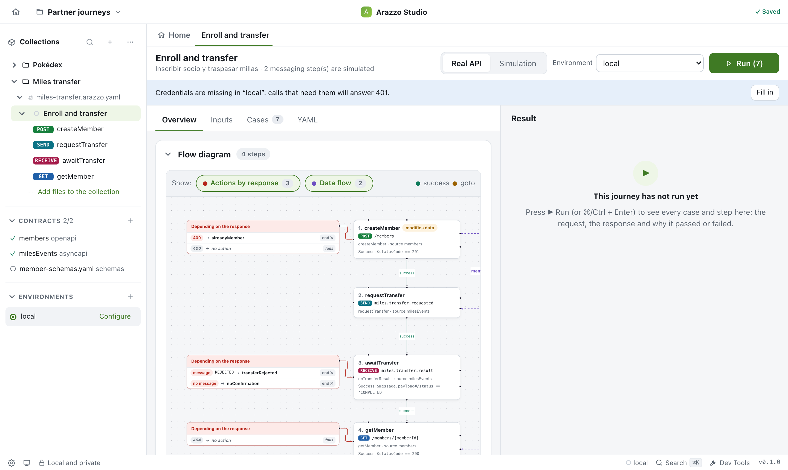

</div>

<br>

## Contents

- [Why Arazzo Studio](#why-arazzo-studio)
- [Who it is for](#who-it-is-for)
- [Features](#features)
- [Quick start](#quick-start) · [Guided tour](#guided-tour-and-example)
- [How it works](#how-it-works)
- [Privacy and security](#privacy-and-security)
- [Specification support](#specification-support)
- [Known limitations](#known-limitations)
- [Roadmap](#roadmap)
- [Languages](#languages)
- [For contributors](#for-contributors)
- [License](#license)

## Why Arazzo Studio

Most integrations are not one API call but a **journey**: enroll a member, add card benefits, transfer miles. Each API is usually documented and tested on its own, so nobody can easily check that the whole journey works, and only engineers can try it.

[Arazzo](https://spec.openapis.org/arazzo/latest.html), the OpenAPI Initiative's workflow specification, describes those journeys on top of your existing contracts. Arazzo Studio turns that description into something anyone on the team can run:

- 🧭 **See the journey.** Every workflow becomes a diagram with its steps, the actions each response triggers and the data that moves between steps.
- 🧪 **Get the test cases for free.** Happy path, missing or invalid inputs, calls without credentials and one scenario per `onSuccess` / `onFailure` action, derived from the contracts.
- 🎛️ **Try your own data.** Add cases with different parameters, reuse them as YAML and repeat them with generators like `{{email}}` or `{{uuid}}`.
- 🔍 **Understand failures at a glance.** Instead of a raw JSON dump, you read *"`status` is `INACTIVE` but `ACTIVE` was expected"*, with the field highlighted in the response.
- ✍️ **Fix the workflow where you test it.** A built-in editor validates the Arazzo as you type and suggests operations, steps and outputs from the contracts.
- 📁 **Work like in Bruno.** A workspace is a folder: each collection is a subfolder with its Arazzo files, contracts, environments and cases as plain files you can keep in git. Every change is saved automatically.
- 📜 **Edit contracts like in Swagger Editor.** YAML next to the official Swagger UI, with live errors and a warning when a change breaks a journey. Try any operation on its own with your environment.
- 🔒 **Stay local.** No backend and no account. Secrets and credentials are encrypted on your computer and never written to the workspace files.
- 🖥️ **Browser or desktop.** The desktop app sends requests without CORS restrictions and adds an integrated terminal.

## Who it is for

- **API product and partner teams** who sell or document journeys made of several APIs, and need to show they work end to end.
- **Product managers and business roles** who need to try a journey with their own data, without a CLI, a paid tool or test code.
- **QA and integration engineers** who want generated negative cases, clear verdicts, a shareable report and Dev Tools with every request.
- **API designers** writing Arazzo files, who want live validation against the real contracts.

Arazzo Studio is built for **exploring, debugging and demonstrating** journeys by hand. It is not a CI runner: for pipelines, a command-line runner such as [Redocly Respect](https://redocly.com/docs/respect) is a better fit, and both can share the same Arazzo files.

## Features

### A workspace of folders, like Bruno

Create a workspace where you choose (the desktop app suggests `Documents/Arazzo Studio`) and add collections: one per partner or topic. Each collection keeps its Arazzo files, contracts, environments and test cases as plain files, so the whole workspace can live in git and be shared with the team. Every change is saved automatically.

The **Home** tab shows the collections with their folders, quick actions and the workspace documentation, a `README.md` you write and preview right there. Each collection has its own **overview** too: location, version, environments, journeys with the last run, contracts, how to share it, and its documentation, which **Generate docs** drafts from the Arazzo files (journeys, inputs, steps, contracts and environments).

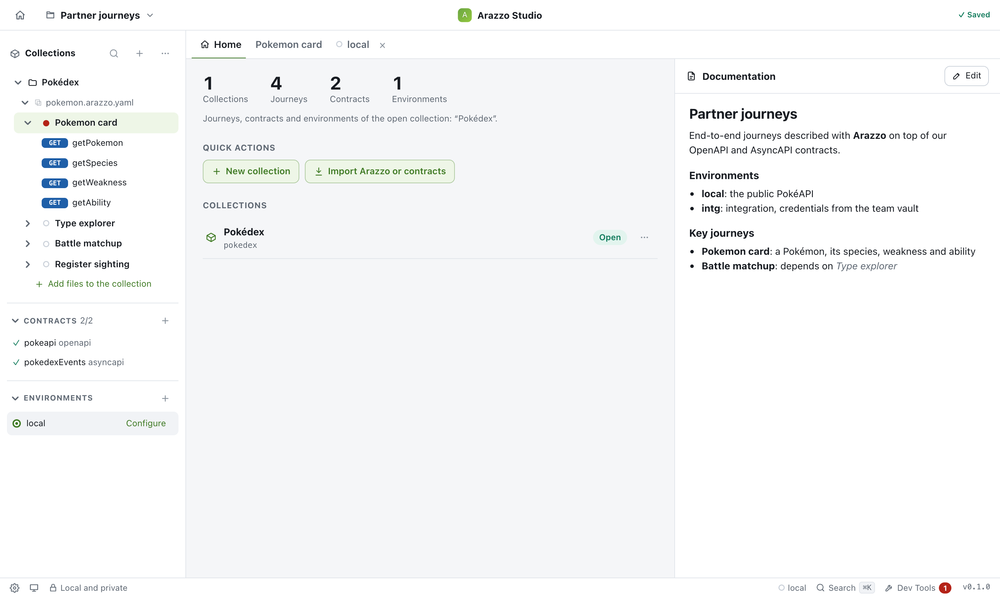

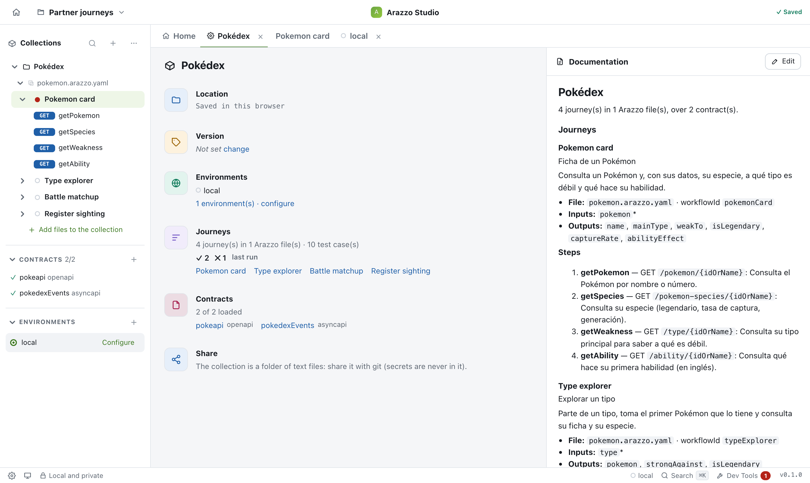

```
partner-journeys/
  studio.yaml              workspace name and collections
  README.md                workspace documentation
  pokedex/                 a collection
    collection.yaml
    pokemon.arazzo.yaml, pokeapi.openapi.yaml, …
    environments/*.yaml    base URLs, variables and color (secret names only)
    scenarios/<arazzo>     base inputs and custom cases of each Arazzo
```

### Journeys, cases and results side by side

Pick a journey on the left: its diagram, inputs and generated cases are in the middle and the results on the right. Cases cover the happy path, missing or invalid inputs, calls without credentials and one scenario per `onSuccess` / `onFailure` action. Run them against the real API or in simulation, add your own data cases and read every verdict in plain words.


### Environments with variables and secrets

Local, integration, production… each environment has its base URLs, credentials, variables and secrets, plus a color tag. Type `{{` in any field to pick a variable or a generator. Secrets are masked everywhere and stored encrypted on this computer, never in the workspace files.

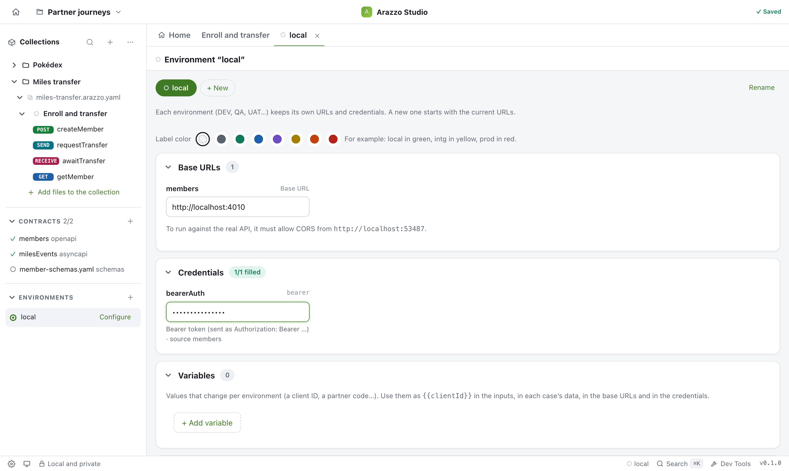

### Contracts like in Swagger Editor

Open any OpenAPI contract to edit its YAML next to the official **Swagger UI**, updated as you type. Errors appear on top with their line, and a banner warns when a change breaks a journey that uses the contract. **Try it out** goes through Arazzo Studio: the environment's server comes first, credentials are already authorized, secrets are masked in the cURL and every call shows up in Dev Tools. Any operation can also be tried on its own from a journey step. Create new OpenAPI or AsyncAPI contracts from the sidebar.

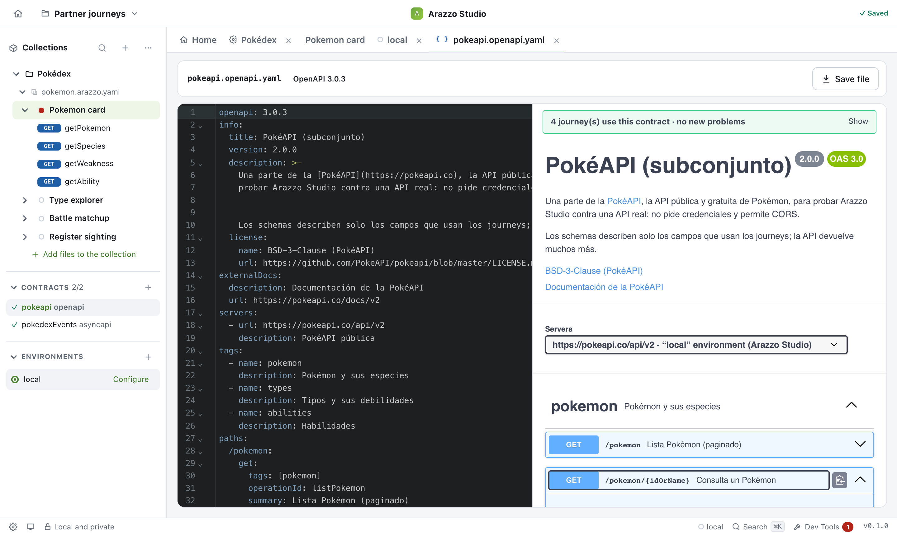

### Journey authorization, per API and per journey

Arazzo doesn't define how to authenticate, and modeling an OAuth 2.0 flow as Arazzo steps is cumbersome (and impossible with *authorization code*). In a journey's **Authorization** tab you pick the authorization for each API it calls: for **all journeys** using that API or **for that journey only**. The most specific one wins, and by default the contract's credentials are used, as before. The same types as in requests are available, including inheriting the collection's. It's applied on every step of every run against the real API: the OAuth 2.0 token is fetched once and reused across steps and cases, and if sign-in is needed a button asks for it before running. The "no credentials" case drops it, and simulation doesn't use it. The Arazzo isn't modified: the setup lives in the collection's `flow-auth.yaml`, without secrets typed as-is.

### Standalone requests: HTTP, GraphQL, gRPC and WebSocket

Like in Postman, each collection can hold its own requests next to its journeys. Create one from **New request** in the sidebar or in the collection's `⋯` menu:

- **HTTP (REST):** method, URL, params, headers, authorization (Bearer, Basic or API key) and body (JSON, text, XML, `x-www-form-urlencoded` or `form-data`). The response shows the status, time, size, formatted body and headers.
- **GraphQL:** query and variables, sent as JSON.
- **gRPC (desktop app):** import the `.proto`, pick the method and write the message from a generated sample. Unary and streaming calls work, and the status code, metadata and trailers are shown.
- **WebSocket:** connect, save several messages to resend, and review the history of what you sent (↑) and received (↓). The connection stays open when you switch tabs.
- **From cURL:** paste a command copied from Chrome, Postman or an API's docs, in the dialog or straight into the URL.

**Authorization**, with the same types as Bruno: AWS Sig v4, Basic, Bearer, Digest, NTLM, OAuth 1.0, OAuth 2.0 (authorization code with PKCE, client credentials and password; the token is fetched and refreshed automatically), WSSE, API Key and Akamai EdgeGrid. Each request can **inherit** the collection's authorization, set up in its overview. Whatever is typed as-is in a secret field is stored encrypted on the computer, not in the file. To share the setup with the team, use environment `{{variables}}`.

They all use the active environment's `{{variables}}`, and their calls show up in Dev Tools with secrets masked. Each request is saved as a readable YAML file at `requests/<name>.request.yaml` inside the collection, and `.proto` files go in `protos/`, so they're versioned with everything else.

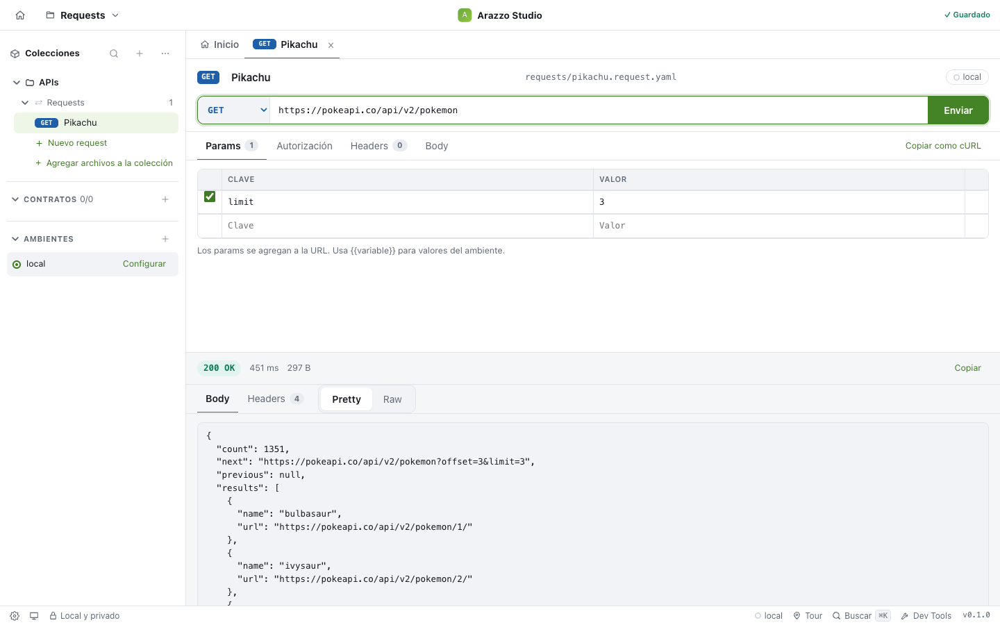

### Edit the Arazzo with live validation

The **YAML** tab of a journey validates the Arazzo as you type. Every problem is underlined on the exact value it refers to, and autocompletion offers operation ids from the loaded contracts (HTTP and AsyncAPI), channels, `$steps.<step>.outputs.<name>`, `$inputs`, `dependsOn` and `goto` targets.

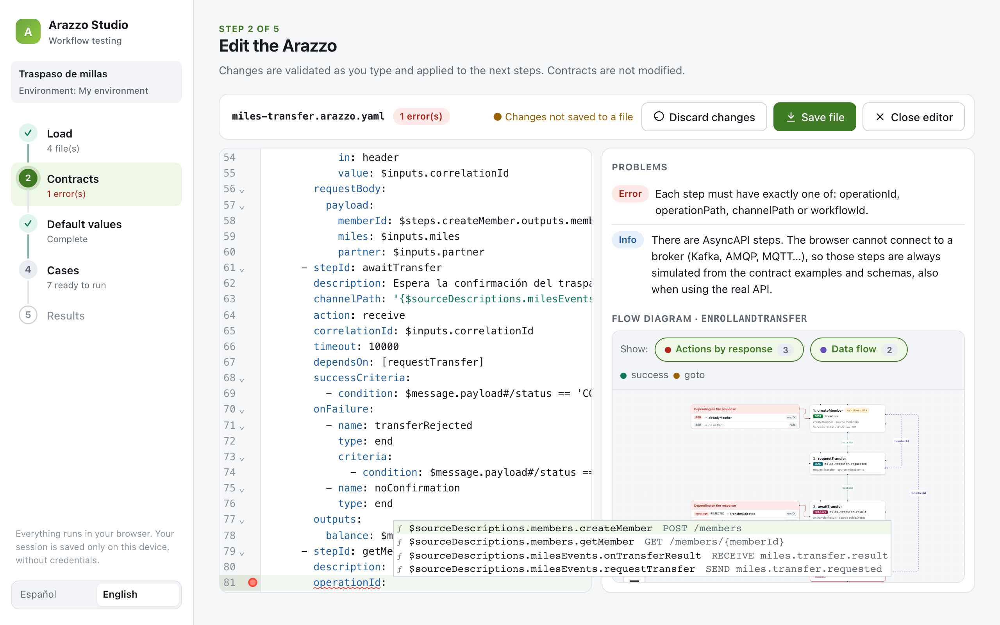

### Dev Tools: Console, Network, Performance and Terminal

Like Bruno, the status bar opens a panel with the **Console** (every run, case and step, and app events), **Network** (every request and message with headers, body and *Copy as cURL*, secrets masked), **Performance** (CPU, memory and time per step) and, in the desktop app, a **Terminal** with several sessions that opens in the workspace or collection folder. The **Simple** interface (Preferences) hides all of it for people who only test journeys.

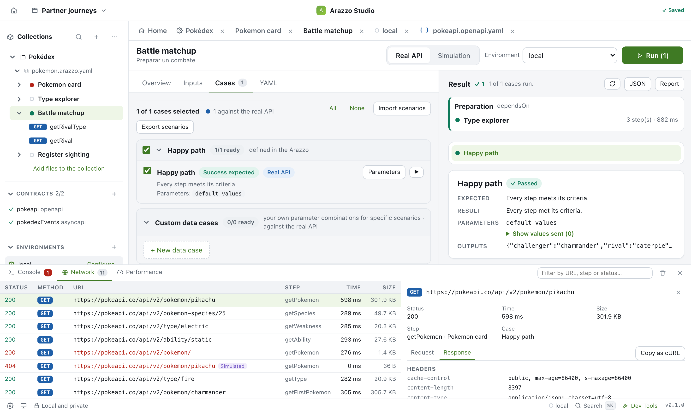

### Event-driven steps (AsyncAPI)

Journeys often mix REST calls with events. Steps that `send` or `receive` an AsyncAPI message appear in the diagram and the results like any other step: the message sent, the message received (matched by `correlationId`), its contract check and the outputs taken from `$message`. Generated scenarios cover the message that triggers each action and the case where no message arrives before the `timeout`.

> [!NOTE]
> Arazzo Studio does not connect to brokers such as Kafka, AMQP or MQTT yet, so messaging steps are **always simulated** from the AsyncAPI examples and schemas. The app says so before running and marks those steps as simulated, also when the rest of the journey runs against the real API.

### And also

| Feature | What it does |
|---|---|
| 🔎 **Search everywhere** | ⌘K / Ctrl+K jumps to any journey, step, environment, contract or collection. The sidebar search filters the tree as you type. |
| 🗺️ **Interactive diagram** | Drag the steps around; their actions move with them, and **Reset layout** brings back the automatic one. |
| 📋 **Copy as cURL** | Reproduce any request from your terminal. Secrets become `<secret>`. |
| 🛟 **Connection help** | If the API does not answer, a guided panel explains what to check (URL, https/http, CORS) and gives you the exact CORS headers to add. |
| 🎲 **Generators** | Postman-style dynamic variables powered by [Faker](https://fakerjs.dev) (`{{$randomFirstName}}`, `{{$randomEmail}}`, `{{$guid}}`… 47 in total) plus `{{cpf}}`, `{{rut}}` and `{{number:8}}`. |
| 📄 **Reports** | A self-contained HTML report or a JSON export of every run. |
| 🌙 **Themes** | Light, dark or the system's, from the status bar or Preferences. |
| 💾 **Without a workspace** | Open files or a folder for a quick try; your session is saved on this device without credentials. |

<details>
<summary><strong>Dark mode preview</strong></summary>
<br>
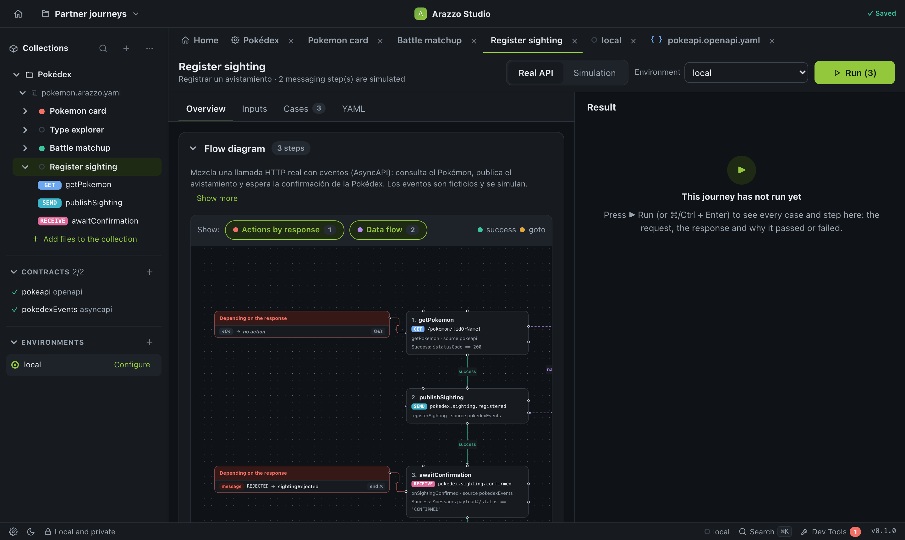
</details>

## Quick start

Requirements: **Node.js 20.19+ or 22.12+** (required by Vite 8).

```bash
npm install
npm run dev          # http://localhost:5173
```

The build is a static site (`npm run build` → `dist/`), so it can be served from any static host or an internal server. The people who use it only need a browser.

### Desktop app

The same app, packaged with Electron. Workspaces live in real folders on disk (with **Show in Finder**), secrets are encrypted with the operating system's keychain, requests are sent from the app itself, so **CORS does not apply**, and Dev Tools adds a **Terminal**.

```bash
npm run desktop:dev      # run the desktop app against the dev server
npm run desktop:build    # build the installer for your OS into release/
```

> [!NOTE]
> Installers are **not signed** yet. On macOS, open the app the first time with right click → **Open**; on Windows, choose **More info → Run anyway**.

### Guided tour and example

The welcome screen offers a **guided tour** (also in Preferences): in about five minutes it walks through every feature on a **Pokédex** that calls the real [PokéAPI](https://pokeapi.co), a public API with no credentials and CORS allowed. It creates a test workspace, runs the journeys against the real API and, at the end, lets you keep or delete it. **Try the example** opens the same Pokédex without a workspace.

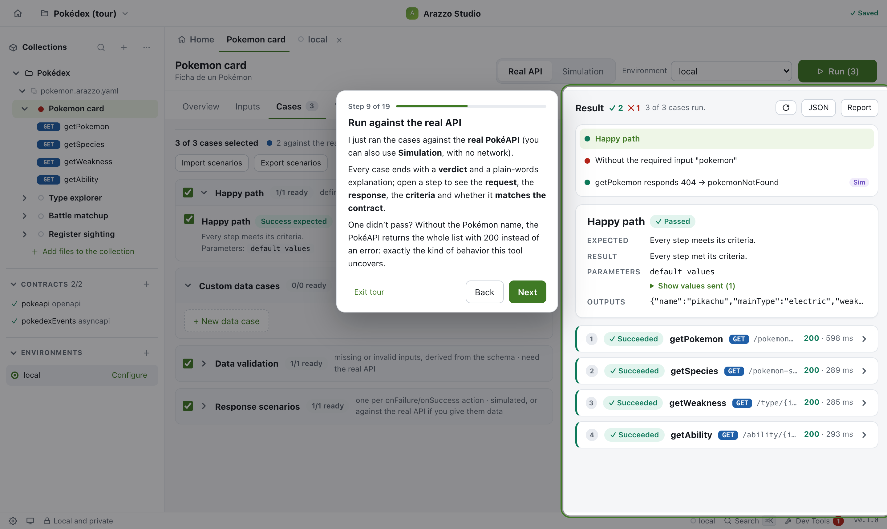

| Journey | What it shows |
|---|---|
| **Pokemon card** | Four steps that chain each other's outputs (a Pokémon, its species, its weakness, its ability), JSONPath criteria and a 404 end action. |
| **Type explorer** | A type, its first Pokémon and its species. |
| **Battle matchup** | Workflow `dependsOn`: runs after *Type explorer* and uses its outputs to find a rival. |
| **Register sighting** | A real HTTP call plus AsyncAPI `send` / `receive` steps with a `correlationId` and a `timeout`. These events are fictional and always simulated. |

The example files live in [examples/pokemon/](examples/pokemon/).

## How it works

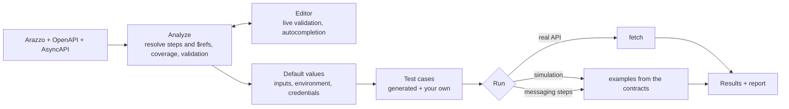

1. **Contracts.** Each step is resolved to its OpenAPI operation or AsyncAPI channel. A coverage table shows which documented responses the Arazzo handles, and validation flags missing operations, required parameters that are never sent, broken references and steps that depend on steps that run later.
2. **Default values.** The values every case starts from, plus the environment (base URLs and credentials taken from the `securitySchemes`).
3. **Test cases.** General cases run against the real API or in simulation. Response and message scenarios are simulated from the contract examples (or the schema when there are none) and check that the right action fires. HTTP scenarios can be switched to the real API by giving them the data that triggers that response.
4. **Results.** Every case ends with a verdict (passed, failed or inconclusive) and a reason in plain words.

> [!IMPORTANT]
> In the **browser version**, requests are sent from the browser, so the API under test must allow **CORS** from the app's origin (for example `http://localhost:5173`) and list the headers your workflows send in `Access-Control-Allow-Headers`. When a request is blocked, the app shows a guided panel with the exact headers to add. The **desktop app** sends requests from the app itself, so CORS does not apply.

## Privacy and security

- Everything runs **on your machine**, in the browser or the desktop app. There is no backend and no account.
- **Secrets and credentials are never written to the workspace files**: environment files only keep the names of the secrets. Their values are stored **encrypted on this computer**, with the operating system's keychain in the desktop app (Electron `safeStorage`) and with WebCrypto in the browser.
- Tokens, passwords and API keys are **masked** in results, reports, exports, Dev Tools, the Swagger UI cURL and *Copy as cURL*.
- The desktop app only reads and writes inside folders you chose, and its interface has no direct access to Node or the file system. The integrated terminal opens your own shell, only in a workspace folder or your home folder.
- Without a workspace, the saved session (IndexedDB) leaves out credentials and any input whose name looks sensitive (`token`, `password`, `secret`…).

## Specification support

Arazzo **1.0.x** and **1.1.x** documents are supported, with OpenAPI **3.x** and AsyncAPI **2.x** and **3.x** contracts.

| Feature | Status |
|---|---|
| `operationId` (plain and `$sourceDescriptions.x.opId`) | ✅ Supported |
| `operationPath` | ✅ Supported |
| Steps with `workflowId` (sub-workflows) | ✅ Supported |
| Path, query and header parameters | ✅ Supported |
| `in: querystring` parameters (1.1) | ✅ Supported |
| Cookie parameters and `in: cookie` API keys | ✅ In the desktop app · ⚠️ not on the web (browsers cannot send cookies; the result explains it) |
| `requestBody` with `payload` and `replacements` | ✅ Supported (`targetSelectorType` JSON Pointer, JSONPath and XPath on XML payloads) |
| `successCriteria`: simple, regex and JSONPath | ✅ Supported (JSONPath with jsonpath-plus syntax) |
| `successCriteria` and selectors: XPath | ✅ XPath 1.0 on XML responses (also when `xpath-20` or `xpath-30` is declared, for expressions compatible with 1.0) |
| `onSuccess` / `onFailure`: `end`, `goto`, `retry` | ✅ Supported |
| `parameters` on success and failure actions (1.1) | ✅ Supported for `goto` and `retry` with `workflowId` |
| Selector Object in outputs, parameters and payloads (1.1) | ✅ Supported (JSONPath, JSON Pointer and XPath) |
| `components` (parameters, successActions, failureActions, inputs) | ✅ Supported |
| AsyncAPI sources (1.1): `channelPath`, `action`, `correlationId`, `$message` | ✅ Supported, always simulated |
| Step `timeout` (1.1) | ✅ Supported |
| Step `dependsOn` (1.1) | ✅ Checked in the analysis and before each step; steps run in document order |
| Workflow `dependsOn` | ✅ The workflows it depends on run first (once per run) and their outputs are available as `$workflows.<id>.outputs`; cycles are detected. Same document only |
| External `$ref` in OpenAPI, AsyncAPI and Arazzo files | ✅ Supported between loaded files (and fetched next to a contract downloaded from its URL) |

## Known limitations

- **Messaging steps are simulated.** Arazzo Studio does not connect to brokers yet.
- **CORS (browser version only).** The API under test has to allow the app's origin. Browsers cannot send cookies or the `Host` header, and only read the response headers the API exposes. The desktop app has none of these restrictions: cookies are sent there.
- **Unsigned desktop installers.** macOS and Windows show a warning the first time the app is opened.
- **Tested on macOS.** The Windows and Linux builds have not been tried on those systems yet; on Linux the terminal needs to build its native module when installing.
- **gRPC only in the desktop app**, because browsers can't open gRPC connections. Server reflection isn't used yet, so the `.proto` is required. Client-streaming methods send a single message.
- **NTLM only in the desktop app**, since its handshake needs a single connection. OAuth 2.0 tokens are kept in memory only while the collection is open. In the web version the *authorization code* returns to `<origin>/oauth2/callback`, which must be registered with the provider.
- **No custom WebSocket headers.** Browsers don't allow them; use URL params instead.
- **`form-data` with text fields only** (file attachments aren't supported yet).
- **Swagger UI for OpenAPI only.** AsyncAPI contracts and schema files use Arazzo Studio's own preview.
- **XPath 1.0.** Functions specific to XPath 2.0 or 3.0 are not available.
- **`retry` with `stepId`** is not run automatically, and **`dependsOn` on another Arazzo document** is reported but not run.
- **Not a CI runner.** Runs are started by a person in the browser.
- **No hosted version yet.** Run it locally, use the desktop app or serve the static build yourself.

## Roadmap

Planned next steps, in no fixed order:

- **Online demo** with the built-in examples, so the app can be tried without installing anything.
- **Real messaging in the desktop app:** connect `send` / `receive` steps to Kafka, AMQP or MQTT instead of simulating them.
- **Signed desktop installers** with automatic updates.
- **AI-assisted editing** (opt-in, with your own API key): describe a change in plain words and review it as a diff before applying it.
- **Richer diagram:** `dependsOn` arrows and timeouts on the steps.
- **Editable simulations:** adjust the simulated response or message of a scenario to try business cases without touching YAML.
- **Generate a first Arazzo from the contracts** (or with AI), so teams without Arazzo files can start in minutes.
- **Add a tried operation as a step** of the Arazzo.

Ideas and feedback are welcome in the [issues](https://github.com/bvegaM/arazzo-studio/issues).

## Languages

The interface is available in **English** and **Spanish**. The initial language follows the browser and can be changed in **Preferences** (status bar). Engine messages and the HTML report are translated too. Scenario files keep the same keys in both languages, so they stay compatible.

## For contributors

### Project structure

```
src/
  app/          app composition: workspace layout, state (useStudio, useWorkspace),
                sidebar, top bar, status bar, home
  core/         UI-independent engine (no React, no DOM): loader and $ref bundling,
                OpenAPI and AsyncAPI resolution, analysis, runner, criteria,
                simulator, test cases, contract lint, workspace format, report…
  i18n/         translations (en, es), t() and the useLocale hook
  lib/          browser and desktop utilities (storage, workspace files, secrets,
                desktop bridge, Dev Tools log, theme)
  ui/
    components/ reusable pieces (flow diagram, Arazzo and contract editors,
                Swagger UI preview, schema form, menus…)
    workspace/  the views of a workspace (journey, cases, results, environments,
                Dev Tools, terminal, home…)
    requests/   standalone requests (HTTP, GraphQL, gRPC, WebSocket) and the "New request" dialog
electron/       desktop app: main process (HTTP without CORS, gRPC, files, secrets, terminal),
                preload bridge, dev launcher
examples/       the Pokédex example (PokéAPI)
test/fixtures/  Arazzo files, contracts and the mock API used by the tests
e2e/            end-to-end smoke test of the UI
docs/           screenshots
```

`core` never imports from `ui`, `app` or `lib`, so the engine can be reused outside the browser. HTTP calls go through an `HttpExecutor` (`fetch` in the browser, the Electron main process on desktop, or the contract-based simulator) and messaging steps through a `MessageExecutor` (today, the simulator). The flow diagram (React Flow) and the editor (CodeMirror) are loaded on demand to keep the initial bundle small.

### Scripts

| Command | What it does |
|---|---|
| `npm run dev` | Start the dev server |
| `npm run build` | Type-check and build for production |
| `npm run preview` | Preview the production build |
| `npm test` | Run the unit tests (engine, criteria, analysis, editor helpers, contracts, workspace format) |
| `npm run test:e2e` | Open the app in the installed Chrome and walk through the main flows (`CHROME_PATH` to override) |
| `npm run typecheck` | Type-check the app, the config and the tests |
| `npm run lint` | Lint with oxlint |
| `npm run mock` / `npm run mock:bug` | Start the mock APIs of the test fixtures (correct / with contract errors) |
| `npm run desktop:dev` | Run the desktop app against the dev server |
| `npm run desktop:build` | Build the desktop installer for the current OS into `release/` |

### Adding a text

Add its key to `src/i18n/locales/es/` and the translation to `src/i18n/locales/en/`. TypeScript reports any missing key.

## License

[MIT](LICENSE) © bvegam

<sub>Arazzo and OpenAPI are specifications of the <a href="https://www.openapis.org">OpenAPI Initiative</a>, and AsyncAPI of the <a href="https://www.asyncapi.com">AsyncAPI Initiative</a>. This project is not affiliated with or endorsed by either.</sub>
