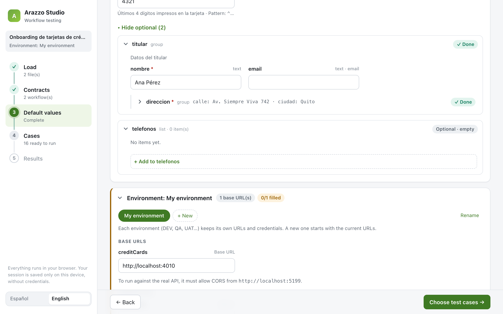
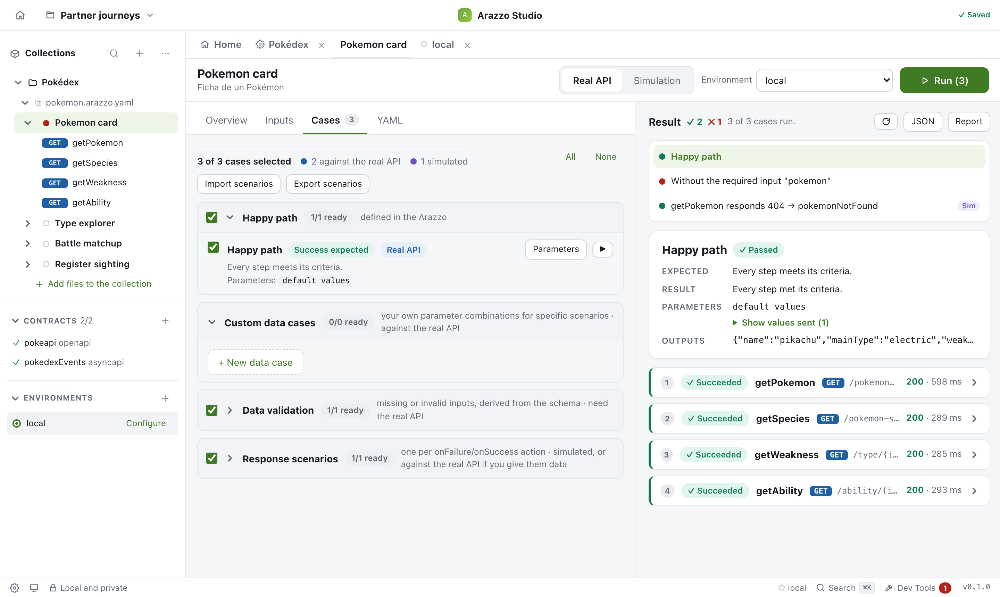
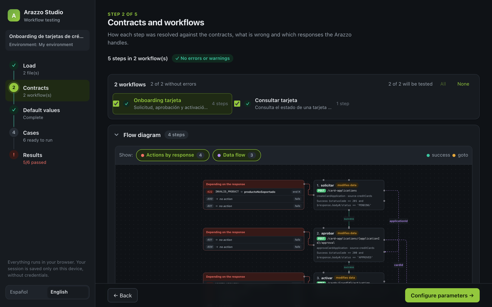
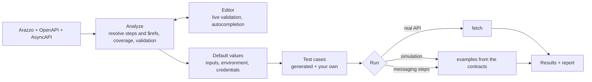

<div align="center">


# Arazzo Studio

**Test your API journeys without writing tests.**

Load an [Arazzo](https://spec.openapis.org/arazzo/latest.html) workflow and the OpenAPI and AsyncAPI contracts behind it. Arazzo Studio draws the journey, generates the test cases, runs them against your API or in simulation, and explains every result in plain words. Use it in the browser or as a desktop app, with no account and nothing that leaves your machine.

[](https://spec.openapis.org/arazzo/latest.html)
[](https://spec.openapis.org/oas/latest.html)
[](https://www.asyncapi.com/docs/reference/specification/latest)
[](#languages)
[](LICENSE)
<br>
[](https://react.dev)
[](https://www.typescriptlang.org)
[](https://vite.dev)
[](https://reactflow.dev)
[](https://codemirror.net)
[](https://vitest.dev)
[](https://www.electronjs.org)

**English** · [Español](README.es.md)

<br>


</div>

<br>

## Contents

- [Why Arazzo Studio](#why-arazzo-studio)
- [Who it is for](#who-it-is-for)
- [Features](#features)
- [Quick start](#quick-start)
- [How it works](#how-it-works)
- [Privacy and security](#privacy-and-security)
- [Specification support](#specification-support)
- [Known limitations](#known-limitations)
- [Roadmap](#roadmap)
- [Languages](#languages)
- [For contributors](#for-contributors)
- [License](#license)

## Why Arazzo Studio

Most integrations are not one API call but a **journey**: enroll a member, add card benefits, transfer miles. Each API is usually documented and tested on its own, so nobody can easily check that the whole journey works, and only engineers can try it.

[Arazzo](https://spec.openapis.org/arazzo/latest.html), the OpenAPI Initiative's workflow specification, describes those journeys on top of your existing contracts. Arazzo Studio turns that description into something anyone on the team can run:

- 🧭 **See the journey.** Every workflow becomes a diagram with its steps, the actions each response triggers and the data that moves between steps.
- 🧪 **Get the test cases for free.** Happy path, missing or invalid inputs, calls without credentials and one scenario per `onSuccess` / `onFailure` action, derived from the contracts.
- 🎛️ **Try your own data.** Add cases with different parameters, reuse them as YAML and repeat them with generators like `{{email}}` or `{{uuid}}`.
- 🔍 **Understand failures at a glance.** Instead of a raw JSON dump, you read *"`status` is `INACTIVE` but `ACTIVE` was expected"*, with the field highlighted in the response.
- ✍️ **Fix the workflow where you test it.** A built-in editor validates the Arazzo as you type and suggests operations, steps and outputs from the contracts.
- 🔒 **Stay local.** No backend and no account. Contracts, credentials and responses never leave your machine.
- 🖥️ **Browser or desktop.** The desktop app works on folders like an API client such as Bruno: it opens your project folder, saves the Arazzo back to its file and sends requests without CORS restrictions.

## Who it is for

- **API product and partner teams** who sell or document journeys made of several APIs, and need to show they work end to end.
- **Product managers and business roles** who need to try a journey with their own data, without a CLI, a paid tool or test code.
- **QA and integration engineers** who want generated negative cases, clear verdicts and a shareable report.
- **API designers** writing Arazzo files, who want live validation against the real contracts.

Arazzo Studio is built for **exploring, debugging and demonstrating** journeys by hand. It is not a CI runner: for pipelines, a command-line runner such as [Redocly Respect](https://redocly.com/docs/respect) is a better fit, and both can share the same Arazzo files.

## Features

<table>
  <tr>
    <td width="50%" valign="top">
      
      <h3>1 · Load</h3>
      Drop one or more Arazzo files (a collection: one journey per workflow), the OpenAPI and AsyncAPI contracts they reference and any file they point to with <code>$ref</code>. Missing contracts and referenced files are pointed out; contracts can be attached by hand or fetched from their URL.
    </td>
    <td width="50%" valign="top">
      
      <h3>2 · Fill in the data</h3>
      A form built from the <code>inputs</code> schema, with nested objects and lists edited field by field. Values are checked against the contract while you type (pattern, length, range, format).
    </td>
  </tr>
  <tr>
    <td width="50%" valign="top">
      
      <h3>3 · Choose test cases</h3>
      Generated cases grouped by type, each with its own parameters. Run them against the real API or in simulation, add your own data cases and import or export scenarios as YAML.
    </td>
    <td width="50%" valign="top">
      
      <h3>4 · Review the results</h3>
      Live progress while it runs, then the request, the response, the criteria, the contract check and the outputs of every step. Download a self-contained HTML report or a JSON export.
    </td>
  </tr>
</table>

### Edit the Arazzo with live validation

Open **Edit Arazzo** from the contracts screen to change the workflow next to its diagram. Every problem is underlined on the exact value it refers to, the diagram updates as you type, and autocompletion offers what is hard to remember: operation ids from the loaded contracts (HTTP and AsyncAPI), channels, `$steps.<step>.outputs.<name>`, `$inputs`, `dependsOn` and `goto` targets. Save the file back to disk or download it; the contracts are never modified.


### Expected vs. received, side by side

When a criterion fails, Arazzo Studio shows exactly which field is wrong and jumps to it in the response body. It also works for regex criteria over a JSON body.


### Event-driven steps (AsyncAPI)

Journeys often mix REST calls with events. Steps that `send` or `receive` an AsyncAPI message appear in the diagram and the results like any other step: the message sent, the message received (matched by `correlationId`), its contract check and the outputs taken from `$message`. Generated scenarios cover the message that triggers each action and the case where no message arrives before the `timeout`.


> [!NOTE]
> Arazzo Studio does not connect to brokers such as Kafka, AMQP or MQTT yet, so messaging steps are **always simulated** from the AsyncAPI examples and schemas. The app says so before running and marks those steps as simulated, also when the rest of the journey runs against the real API.

### And also

| Feature | What it does |
|---|---|
| 🌍 **Environments** | DEV, QA, UAT… each with its own base URLs and credentials. Switching environments asks again before running steps that modify data. |
| 🗺️ **Interactive diagram** | Drag the steps around; their actions move with them, the layout is kept while you edit, and **Reset layout** brings back the automatic one. |
| 📋 **Copy as cURL** | Reproduce any request from your terminal. Secrets are replaced with `<secret>` unless you choose to copy them. |
| 🛟 **Connection help** | If the API does not answer, a guided panel explains what to check (URL, https/http, CORS) and gives you the exact CORS headers to add. |
| ✅ **Pick your workflows** | Select which workflows to test. The following steps only show the ones you picked. |
| 💾 **Session restore** | Your work, including edits to the Arazzo, is saved on this device and offered back when you return. Credentials are never stored. |
| 🎲 **Generators** | Postman-style dynamic variables powered by [Faker](https://fakerjs.dev) (`{{$randomFirstName}}`, `{{$randomEmail}}`, `{{$randomUserAgent}}`, `{{$guid}}`… 47 in total) plus `{{cpf}}`, `{{rut}}` and `{{number:8}}`, so cases can be repeated without clashes. Type `{{` in any field to see them. |
| 🌙 **Dark mode** | Follows your system theme. |

<details>
<summary><strong>Dark mode preview</strong></summary>
<br>

</details>

## Quick start

Requirements: **Node.js 20.19+ or 22.12+** (required by Vite 8).

```bash
npm install
npm run dev          # http://localhost:5173
```

The build is a static site (`npm run build` → `dist/`), so it can be served from any static host or an internal server. The people who use it only need a browser.

### Desktop app

The same app, packaged with Electron. It adds **Open folder** (every YAML and JSON file in a folder and its subfolders), saves the edited Arazzo **back to its file**, and sends requests from the app itself, so **CORS does not apply**.

```bash
npm run desktop:dev      # run the desktop app against the dev server
npm run desktop:build    # build the installer for your OS into release/
```

> [!NOTE]
> Installers are **not signed** yet. On macOS, open the app the first time with right click → **Open**; on Windows, choose **More info → Run anyway**.

### Try the built-in examples

Both examples are one click away on the load screen. To run them against a real API instead of the simulation, start the bundled mock:

```bash
npm run mock         # example APIs at http://localhost:4010
npm run mock:bug     # same APIs, with contract violations on purpose
```

| Example | What it shows | How to run it |
|---|---|---|
| **Collection** | Both examples below in one collection: two Arazzo files, three journeys, shared environments. | As each example. |
| **Credit cards** | A four-step onboarding over one OpenAPI contract: generated cases, response scenarios, contract violations. | Any token as the credential and `4321` as `last4Digits`. |
| **Miles transfer** | An Arazzo 1.1 journey: an OpenAPI contract split with external `$ref`s, AsyncAPI `send` / `receive` steps, `correlationId`, `timeout` and `dependsOn`. | Any token as the credential. The messaging steps are simulated. |

The example files live in [examples/](examples/).

## How it works



1. **Contracts.** Each step is resolved to its OpenAPI operation or AsyncAPI channel. A coverage table shows which documented responses the Arazzo handles, and validation flags missing operations, required parameters that are never sent, broken references and steps that depend on steps that run later.
2. **Default values.** The values every case starts from, plus the environment (base URLs and credentials taken from the `securitySchemes`).
3. **Test cases.** General cases run against the real API or in simulation. Response and message scenarios are simulated from the contract examples (or the schema when there are none) and check that the right action fires. HTTP scenarios can be switched to the real API by giving them the data that triggers that response.
4. **Results.** Every case ends with a verdict (passed, failed or inconclusive) and a reason in plain words.

> [!IMPORTANT]
> In the **browser version**, requests are sent from the browser, so the API under test must allow **CORS** from the app's origin (for example `http://localhost:5173`) and list the headers your workflows send in `Access-Control-Allow-Headers`. When a request is blocked, the app shows a guided panel with the exact headers to add. The **desktop app** sends requests from the app itself, so CORS does not apply.

## Privacy and security

- Everything runs **on your machine**, in the browser or the desktop app. There is no backend and no account.
- The desktop app only writes to files you opened or chose in a dialog, and its interface has no direct access to Node or the file system.
- Credentials live **only in the open tab**: they are never saved, exported or included in reports.
- Tokens, passwords and API keys are **masked** in results, reports, exports and cURL commands (unless you explicitly copy them).
- The saved session (IndexedDB) leaves out credentials and any input whose name looks sensitive (`token`, `password`, `secret`…).

## Specification support

Arazzo **1.0.x** and **1.1.x** documents are supported, with OpenAPI **3.x** and AsyncAPI **2.x** and **3.x** contracts.

| Feature | Status |
|---|---|
| `operationId` (plain and `$sourceDescriptions.x.opId`) | ✅ Supported |
| `operationPath` | ✅ Supported |
| Steps with `workflowId` (sub-workflows) | ✅ Supported |
| Path, query and header parameters | ✅ Supported |
| `in: querystring` parameters (1.1) | ✅ Supported |
| Cookie parameters | ❌ Not supported (browser restriction) |
| `requestBody` with `payload` and `replacements` | ✅ Supported (`targetSelectorType` JSON Pointer and JSONPath) |
| `successCriteria`: simple, regex and JSONPath | ✅ Supported (JSONPath with jsonpath-plus syntax) |
| `successCriteria` and selectors: XPath | ❌ Not supported |
| `onSuccess` / `onFailure`: `end`, `goto`, `retry` | ✅ Supported |
| `parameters` on success and failure actions (1.1) | ✅ Supported for `goto` and `retry` with `workflowId` |
| Selector Object in outputs, parameters and payloads (1.1) | ✅ Supported (JSONPath and JSON Pointer) |
| `components` (parameters, successActions, failureActions, inputs) | ✅ Supported |
| AsyncAPI sources (1.1): `channelPath`, `action`, `correlationId`, `$message` | ✅ Supported, always simulated |
| Step `timeout` (1.1) | ✅ Supported |
| Step `dependsOn` (1.1) | ✅ Checked in the analysis and before each step; steps run in document order |
| Workflow `dependsOn` | ⚠️ Not run automatically |
| External `$ref` in OpenAPI, AsyncAPI and Arazzo files | ✅ Supported between loaded files (and fetched next to a contract downloaded from its URL) |

## Known limitations

- **Messaging steps are simulated.** Arazzo Studio does not connect to brokers yet.
- **CORS (browser version only).** The API under test has to allow the app's origin. Browsers cannot send cookies or the `Host` header, and only read the response headers the API exposes. The desktop app has none of these restrictions.
- **Unsigned desktop installers.** macOS and Windows show a warning the first time the app is opened.
- **XPath** in criteria and selectors is not supported.
- **`retry` with `stepId`** and **workflow-level `dependsOn`** are not run automatically.
- **Not a CI runner.** Runs are started by a person in the browser.
- **No hosted version yet.** Run it locally, use the desktop app or serve the static build yourself.

## Roadmap

Planned next steps, in no fixed order:

- **Online demo** with the built-in examples, so the app can be tried without installing anything.
- **Real messaging in the desktop app:** connect `send` / `receive` steps to Kafka, AMQP or MQTT instead of simulating them.
- **Signed desktop installers** with automatic updates.
- **AI-assisted editing** (opt-in, with your own API key): describe a change in plain words and review it as a diff before applying it.
- **Richer diagram:** `dependsOn` arrows and timeouts on the steps.
- **Editable simulations:** adjust the simulated response or message of a scenario to try business cases without touching YAML.
- **Folder upload,** so multi-file contracts come in with one drop.

Ideas and feedback are welcome in the [issues](https://github.com/bvegaM/arazzo-studio/issues).

## Languages

The interface is available in **English** and **Spanish**. The initial language follows the browser and can be changed from the sidebar. Engine messages and the HTML report are translated too. Scenario files keep the same keys in both languages, so they stay compatible.

## For contributors

### Project structure

```
src/
  app/          app composition: screens routing, state (useStudio) and sidebar
  core/         UI-independent engine (no React, no DOM): loader and $ref bundling,
                OpenAPI and AsyncAPI resolution, analysis, runner, criteria,
                simulator, test cases, editor helpers, report, environments, session…
  i18n/         translations (en, es), t() and the useLocale hook
  lib/          browser and desktop utilities (downloads, clipboard, IndexedDB, desktop bridge)
  ui/
    components/ reusable pieces (flow diagram, Arazzo editor, schema form, workflow picker…)
    screens/    one screen per step
electron/       desktop app: main process (HTTP without CORS, files), preload bridge, dev launcher
examples/       credit cards and miles transfer examples, and the mock API
docs/           screenshots
```

`core` never imports from `ui`, `app` or `lib`, so the engine can be reused outside the browser. HTTP calls go through an `HttpExecutor` (`fetch` in the browser, the Electron main process on desktop, or the contract-based simulator) and messaging steps through a `MessageExecutor` (today, the simulator). The flow diagram (React Flow) and the editor (CodeMirror) are loaded on demand to keep the initial bundle small.

### Scripts

| Command | What it does |
|---|---|
| `npm run dev` | Start the dev server |
| `npm run build` | Type-check and build for production |
| `npm run preview` | Preview the production build |
| `npm test` | Run the tests (engine, criteria, analysis, editor helpers, execution against the mock) |
| `npm run typecheck` | Type-check the app, the config and the tests |
| `npm run lint` | Lint with oxlint |
| `npm run mock` / `npm run mock:bug` | Start the example APIs (correct / with contract errors) |
| `npm run desktop:dev` | Run the desktop app against the dev server |
| `npm run desktop:build` | Build the desktop installer for the current OS into `release/` |

### Adding a text

Add its key to `src/i18n/locales/es/` and the translation to `src/i18n/locales/en/`. TypeScript reports any missing key.

## License

[MIT](LICENSE) © bvegam

<sub>Arazzo and OpenAPI are specifications of the <a href="https://www.openapis.org">OpenAPI Initiative</a>, and AsyncAPI of the <a href="https://www.asyncapi.com">AsyncAPI Initiative</a>. This project is not affiliated with or endorsed by either.</sub>
