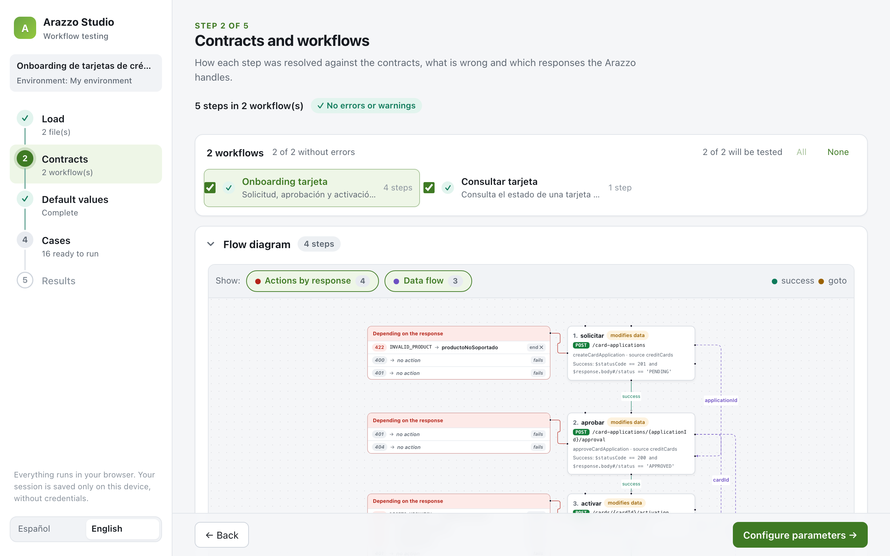
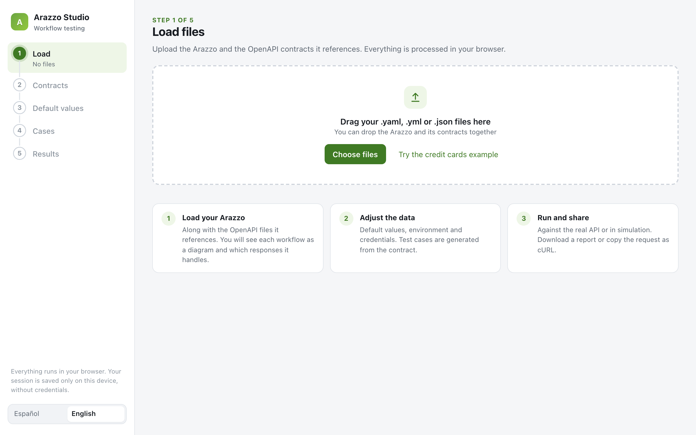
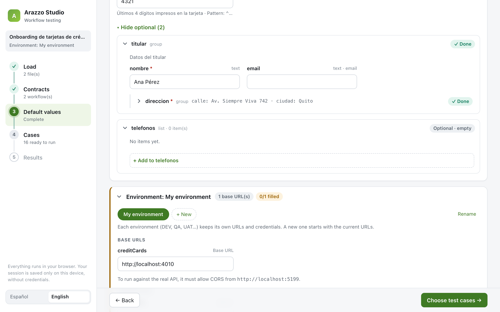
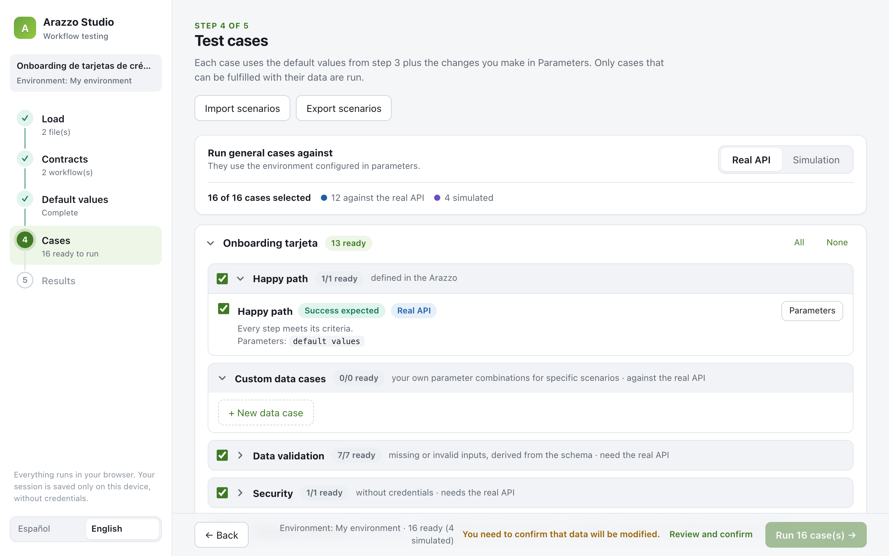
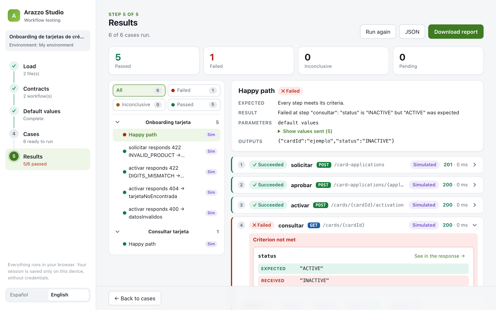
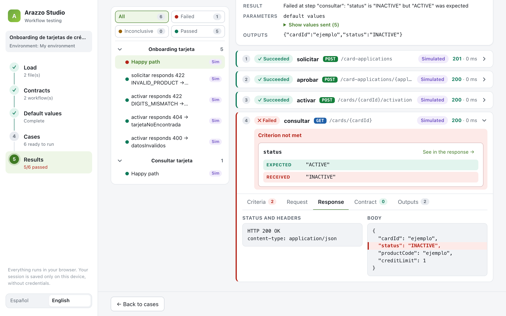
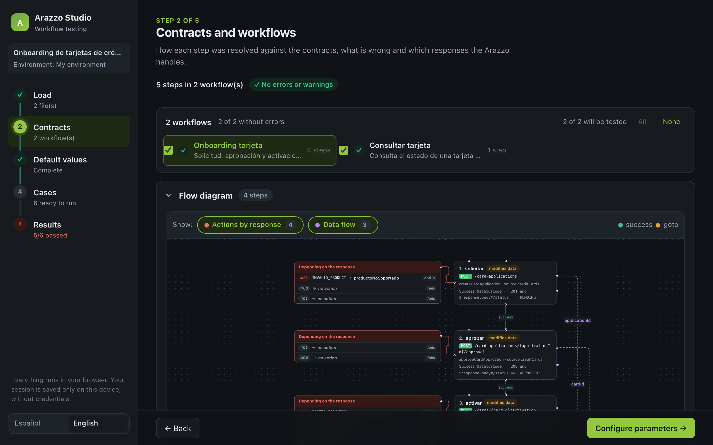
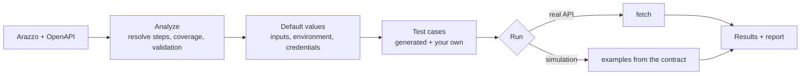

<div align="center">


# Arazzo Studio

**Run and test [Arazzo](https://spec.openapis.org/arazzo/latest.html) workflows against real APIs, right in your browser.**

Load an Arazzo file and its OpenAPI contracts. Arazzo Studio turns them into a visual flow, generates the test cases for you and explains every result in plain words.

[](https://react.dev)
[](https://www.typescriptlang.org)
[](https://vite.dev)
[](https://reactflow.dev)
[](https://vitest.dev)
[](https://oxc.rs)
<br>
[](https://spec.openapis.org/arazzo/latest.html)
[](https://spec.openapis.org/oas/latest.html)
[](#languages)
[](LICENSE)

**English** · [Español](README.es.md)

<br>



</div>

<br>

## Contents

- [Why Arazzo Studio](#why-arazzo-studio)
- [Features](#features)
- [Quick start](#quick-start)
- [How it works](#how-it-works)
- [Privacy and security](#privacy-and-security)
- [Arazzo support](#arazzo-support)
- [Languages](#languages)
- [Project structure](#project-structure)
- [Scripts](#scripts)
- [License](#license)

## Why Arazzo Studio

Arazzo describes **sequences of API calls** (sign up, approve, activate, check status) on top of your OpenAPI contracts. Writing those flows is one thing; checking that they actually work against a real API is another.

Arazzo Studio closes that gap without writing test code:

- 🧭 **See the flow.** Every workflow becomes a diagram with its steps, the actions each response triggers and the data that moves between steps.
- 🧪 **Get the test cases for free.** Happy path, missing or invalid inputs, calls without credentials and one scenario per `onSuccess` / `onFailure` action, all derived from the contracts.
- 🔍 **Understand failures at a glance.** Instead of a raw JSON dump, you see *"`status` is `INACTIVE` but `ACTIVE` was expected"*, with the field highlighted in the response.
- 🔒 **Stay local.** Everything runs in the browser. Contracts, credentials and responses never leave your machine.

## Features

<table>
  <tr>
    <td width="50%" valign="top">
      
      <h3>1 · Load</h3>
      Drop the Arazzo file and the OpenAPI files it references. Missing contracts are pointed out, and they can be attached by hand or fetched from their URL.
    </td>
    <td width="50%" valign="top">
      
      <h3>2 · Fill in the data</h3>
      A form built from the <code>inputs</code> schema, with nested objects and lists edited field by field. Values are checked against the contract while you type (pattern, length, range, format).
    </td>
  </tr>
  <tr>
    <td width="50%" valign="top">
      
      <h3>3 · Choose test cases</h3>
      Generated cases grouped by type, each with its own parameters. Run them against the real API or in simulation, add your own data cases and import or export scenarios as YAML.
    </td>
    <td width="50%" valign="top">
      
      <h3>4 · Review the results</h3>
      Live progress while it runs, then the request, the response, the criteria, the contract check and the outputs of every step. Download a self-contained HTML report or a JSON export.
    </td>
  </tr>
</table>

### Expected vs. received, side by side

When a criterion fails, Arazzo Studio shows exactly which field is wrong and jumps to it in the response body. It also works for regex criteria over a JSON body.



### And also

| Feature | What it does |
|---|---|
| 🌍 **Environments** | DEV, QA, UAT… each with its own base URLs and credentials. Switching environments asks again before running steps that modify data. |
| 📋 **Copy as cURL** | Reproduce any request from your terminal. Secrets are replaced with `<secret>` unless you choose to copy them. |
| 🛟 **Connection help** | If the API does not answer, a guided panel explains what to check (URL, https/http, CORS) and gives you the exact CORS headers to add. |
| ✅ **Pick your workflows** | Select which workflows to test. The following steps only show the ones you picked. |
| 💾 **Session restore** | Your work is saved on this device and offered back when you return. Credentials are never stored. |
| 🎲 **Generators** | `{{email}}`, `{{uuid}}`, `{{number:8}}`, `{{date}}`, `{{timestamp}}`, `{{cpf}}`, `{{rut}}`, so cases can be repeated without clashes. |
| 🌙 **Dark mode** | Follows your system theme. |

<details>
<summary><strong>Dark mode preview</strong></summary>
<br>

</details>

## Quick start

Requirements: **Node.js 20.19+ or 22.12+** (required by Vite 8).

```bash
npm install
npm run dev          # http://localhost:5173
```

### Try it with the bundled example

The repository includes a credit card onboarding Arazzo, its OpenAPI contract and a mock API:

```bash
npm run mock         # mock API at http://localhost:4010
npm run mock:bug     # same API, with contract violations on purpose
```

In the app, click **Try the credit cards example**, use any token as the credential and `4321` as `last4Digits`.

## How it works



1. **Contracts.** Each step is resolved to its OpenAPI operation. A coverage table shows which documented responses the Arazzo handles, and validation flags missing operations, required parameters that are never sent and broken references.
2. **Default values.** The values every case starts from, plus the environment (base URLs and credentials taken from the `securitySchemes`).
3. **Test cases.** General cases run against the real API or in simulation. Response scenarios are simulated from the contract examples (or the schema when there are none) and check that the right action fires. Any scenario can be switched to the real API by giving it the data that triggers that response.
4. **Results.** Every case ends with a verdict (passed, failed or inconclusive) and a reason in plain words.

> [!IMPORTANT]
> Requests are sent from the browser, so the API under test must allow **CORS** from the app's origin (for example `http://localhost:5173`) and list the headers your workflows send in `Access-Control-Allow-Headers`. When a request is blocked, the app shows a guided panel with the exact headers to add. Browsers also cannot send cookies or the `Host` header, and they only read the response headers the API exposes.

## Privacy and security

- Everything runs **client-side**. There is no backend.
- Credentials live **only in the open tab**: they are never saved, exported or included in reports.
- Tokens, passwords and API keys are **masked** in results, reports, exports and cURL commands (unless you explicitly copy them).
- The saved session (IndexedDB) leaves out credentials and any input whose name looks sensitive (`token`, `password`, `secret`…).

## Arazzo support

| Feature | Status |
|---|---|
| `operationId` (plain and `$sourceDescriptions.x.opId`) | ✅ Supported |
| `operationPath` | ✅ Supported |
| Steps with `workflowId` (sub-workflows) | ✅ Supported |
| Path, query and header parameters | ✅ Supported |
| Cookie parameters | ❌ Not supported (browser restriction) |
| `requestBody` with `payload` and `replacements` | ✅ Supported |
| `successCriteria`: simple, regex and JSONPath | ✅ Supported (JSONPath with jsonpath-plus syntax) |
| `successCriteria`: XPath | ❌ Not supported |
| `onSuccess` / `onFailure`: `end`, `goto`, `retry` | ✅ Supported |
| `components` (parameters, successActions, failureActions, inputs) | ✅ Supported |
| `dependsOn` | ⚠️ Not run automatically |
| External `$ref` in OpenAPI files | ❌ Not supported; local `#/...` references only |

## Languages

The interface is available in **English** and **Spanish**. The initial language follows the browser and can be changed from the sidebar. Engine messages and the HTML report are translated too. Scenario files keep the same keys in both languages, so they stay compatible.

To add a text, add its key to `src/i18n/locales/es/` and the translation to `src/i18n/locales/en/`. TypeScript reports any missing key.

## Project structure

```
src/
  app/          app composition: screens routing, state (useStudio) and sidebar
  core/         UI-independent engine (no React, no DOM): loader, analysis, runner,
                criteria, simulator, test cases, report, environments, session, cURL…
  i18n/         translations (en, es), t() and the useLocale hook
  lib/          browser utilities (downloads, clipboard, IndexedDB)
  ui/
    components/ reusable pieces (flow diagram, schema form, workflow picker…)
    screens/    one screen per step
examples/       credit card Arazzo, OpenAPI contract and mock API
docs/           screenshots
```

`core` never imports from `ui`, `app` or `lib`, so the engine can be reused outside the browser. HTTP calls go through an `HttpExecutor` with two implementations: `fetch` for the real API and the contract-based simulator. The flow diagram (React Flow) is loaded on demand to keep the initial bundle small.

## Scripts

| Command | What it does |
|---|---|
| `npm run dev` | Start the dev server |
| `npm run build` | Type-check and build for production |
| `npm run preview` | Preview the production build |
| `npm test` | Run the tests (engine, criteria, analysis, execution against the mock) |
| `npm run typecheck` | Type-check the app, the config and the tests |
| `npm run lint` | Lint with oxlint |
| `npm run mock` / `npm run mock:bug` | Start the example API (correct / with contract errors) |

## License

[MIT](LICENSE) © bvegam

<sub>Arazzo and OpenAPI are specifications of the <a href="https://www.openapis.org">OpenAPI Initiative</a>. This project is not affiliated with or endorsed by the OpenAPI Initiative.</sub>
